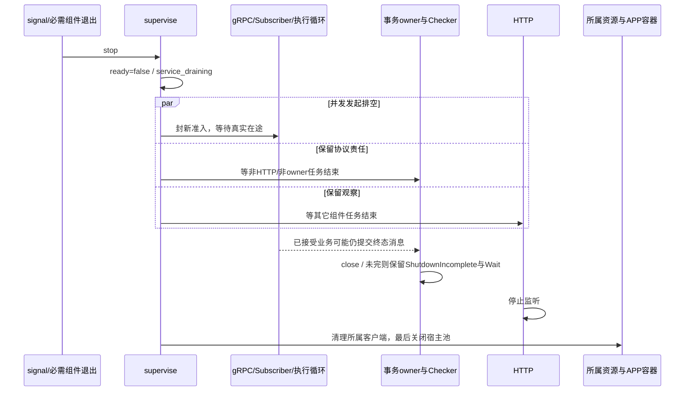

# 生命周期、真实在途与优雅关闭

当前服务只支持原`ai.mysql` RocketMQ事务owner。收到SIGTERM/SIGINT或必需组件提前退出后，先撤销ready并封闭新工作；保留已提交业务、原响应/checkpoint、首wire和Checker恢复责任。退出不保证全部报告完成或全部业务ACK已经收到。

## 谁可以开始关闭，谁负责执行

[server](../../src/qs_ai/bootstrap/server.py)拥有APP容器和顶层监督器；[MessagingRuntime](../../src/qs_ai/bootstrap/messaging.py)拥有事务协议及订阅客户端，借用宿主数据库/loop。构造不启动网络或后台任务。所有必需组件共享故障域，不能在消息组件退出后继续宣称整个服务ready，或并行创建第二组消费者。

## 收到信号以后，实际发生的顺序

监督器的stop/cancel不是数据库回滚证明。组件预算耗尽会记录drain_timeout，继续实际清理；取消后等待和阻塞driver返回可能超出外层预算，不能把它当作墙钟退出SLA。错误日志只保留类别，不输出凭据、wire或正文。

## 各组件在自己的预算中做什么

### 后台执行：先停止下一次领取，允许当前 attempt 结束

run_loop看到stop后不再领取下一项，idle/backoff可被唤醒。已进入的生成/评测按原租约、response/checkpoint和显式取消规则收敛；关闭不会自动写业务canceled、增加attempt或重做未知模型调用。已接受业务在自身drain中可能仍需准备其终态消息，owner不能先关闭其发送能力。

### gRPC 和 Subscriber：已有接入处理排空

gRPC的监听停止与真实handler/root结束是不同边界。当前组件保留原调用的真实在途等待；超过grace不意味着原数据库提交或依赖使用已结束。Subscriber封新接收，等原处理、Inbox/业务/witness及首receipt根收敛；存储错误或取消不能伪造业务拒绝来确认消费。

### 事务owner：业务排空后再关闭协议

`halt_transactions`先等待所有非HTTP、非mq_transactions组件Task，再调用`transactions.close(grace_seconds=5)`。Checker在排空期间保留。空闲/暂停实例仍登记全部owner事务Topic；历史命名`publisher_ready`只表示Start，不表示准入或消费成功。

`MessagingRuntime.close`保留一次实际清理Task，父级重复取消不提前释放仍在运行的线程/RPC。Subscriber部分启动或超时仍可能拥有driver调用；先完成实际stop，再关闭事务owner。`ShutdownIncomplete`继续Wait，之后才清理正文通道和宿主资源；已经完成的RPC错误保留其失败，不无限重试成“成功关闭”。

### HTTP：尽量保留排空期就绪观察

HTTP等待其它任务结束后停止监听，正常drain期间ready已撤销，应返回503；连接或HTTP自身故障仍可能使探针不可达。healthz与readyz含义不同，均不证明业务ACK或报告完成。

## 用生产配置算一次预算，而不是给出退出时限承诺

基础drain取当次已装配gRPC/业务组件shutdown_seconds最大值。Subscriber组件预算为基础值+1，事务owner为基础值+6；诊断保留另有原预算。HTTP取已装配组件的最大预算+4。必须先核对实际启用组件和冻结配置，不能沿用旧Relay/Publisher表格。

这些预算是监督/调用边界。SDK未完成调用、协作取消或原handler/root仍在运行时，资源所有权保持，不能仅凭计时器结束关闭宿主池。源码配置、容器退出与生产实际关闭证据分别核对。

## 退出发生在哪一步，下一次凭什么继续

| 已有事实 | 后续责任 |
| --- | --- |
| 尚无已确认半消息或原业务未启动 | 不伪造接受，不自动重执行业务；协议按原证据收敛 |
| 原根提交结果未知 | 新权威读取精确witness，未查清前保持Unknown |
| 本地Committed、Broker确认Unknown | 原Checker确认；不重新执行业务或模型 |
| response/checkpoint已保存，终态尚未提交 | 原授权和冻结输入下恢复确定性finalization |
| 当前Inbox/receipt/首ACK已提交、消费确认丢失 | 重投复用原身份和首次wire，不重Seal或新建Run |
| provider dispatched/unknown | 保留未知调用治理，不能因重启自动重新调用 |

## 实际停机时应能对上哪些证据

核对service_draining、组件停止、真实在途、SDK未完成计数和最终进程退出；再核对原业务、witness及业务receipt。日志无错误、退出码0或容器healthy均不足以证明业务完成。旧NSQ/MQRelay/历史结果转移不再作为恢复路径。

## 代码与测试怎么查证

[当前生命周期测试](../../tests/test_transaction_transport_lifecycle.py)分别覆盖受控owner、实际固定SDK订阅executor、取消与部分启动；[单进程监听测试](../../tests/test_single_server.py)核对APP资源关闭；[实际配对故障](../../tests/integration/rocketmq_paired_faults.py)证明进程/Broker恢复。受控替身不等于真实网络故障；完整CI、最终镜像、部署及system验收由[infra总表](https://github.com/FangcunMount/infra/blob/main/docs/server/rocketmq-m4-execution.md)分别登记。
