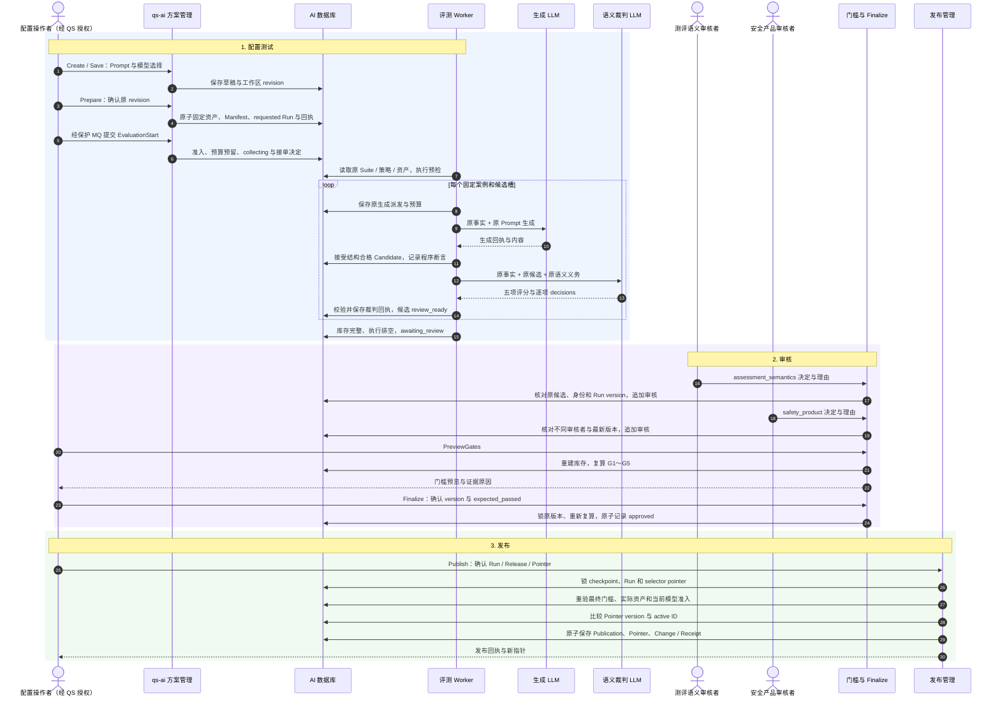

# AI 治理的配置测试、审核与发布流程

AI 治理回答的是：**一套 Prompt、模型和输入输出规则，是否已经取得足够证据，可以用于之后的正式解读？** 流程分为三个步骤：配置测试固定规则并取得候选和裁判证据，审核核对质量门槛与责任人的判断，发布重新验证批准证据并移动生效指针。

治理与单份报告生成有不同目的。治理评测会使用 LLM 做语义裁判，并要求双职责人工审核；[正式报告生成](../interpretation/06-接单到生成与检查流程.md) 使用接单时绑定的发布配置，当前没有逐份 LLM 裁判。一次配置评测获批，不能直接证明所有真实参与者内容都正确。

本文沿一套合成配置迭代解释每个步骤的内部设计、产物、状态与注意点。具体资产、门槛与事务规则分别由 [方案准备](01-方案资产与原子准备设计.md)、[评测审核](../evaluation/01-评测候选门槛与审核设计.md)、[发布设计](../publication/01-发布证据与生效指针设计.md) 维护；本文提供串起这些规则的流程视角。示例数字依据仓库保留的冻结策略，不代表某次生产 Run 已执行、人工已批准或管理入口已启用。

## 三个步骤与完成边界

| 步骤 | 业务问题 | 内部工作 | 成功产物 |
| --- | --- | --- | --- |
| 1. 配置测试 | 用什么规则和样本测试？输出是否稳定、忠实并符合边界？ | 工作区编辑、原子 Prepare、独立 Start、预检、固定槽位生成、程序断言、LLM 语义裁判 | 冻结 Run、候选和原调用证据；完整收集后 awaiting_review |
| 2. 审核 | 证据是否完整？质量达到门槛吗？谁对内容负责？ | G1～G5 复算、双职责人工审核、预览、Finalize | approved 或 rejected 的可核证评测结论 |
| 3. 发布 | 获批资产是否仍一致？哪些新请求应采用它？ | 证据与资产重验、模型准入、指针版本比较、原子发布和审计 | 不可变 Publication、更新后的 Pointer 与原命令回执 |

```text
可编辑 Solution
  → Prepare：固定资产和 requested Run
  → Start：collecting
  → 生成、程序检查、语义评测：awaiting_review
  → 双职责审核 + Finalize
      approved → Publish：新 Publication 成为指定 selector 的 active
      rejected → 停止发布，改方案或按有限资格复审
```

不能将这些完成点合并：Save 不代表配置可执行，Prepare 不启动评测，裁判成功不代表质量通过，awaiting_review 不代表批准，approved 不代表已发布，发布配置也不等于部署服务或用户接受报告。

## 1. 配置测试：先冻结被测规则，再收集固定样本

这一阶段把可编辑意图转成不可随意更换的实验条件，之后在固定案例和有限预算内取得完整证据。其目标是评价原方案，而不是反复生成直到挑到好结果。

### 1.1 创建和保存工作区：编辑内容，不直接改线上规则

Solution 从保留 Publication、现有评测 Run 或精确模板引用中选择一种来源，复制可编辑 Prompt 与模型选择。来源可以提供原配置和审核参考，但不能把旧配置的批准继承给新内容。

Save 的主要编辑范围包括：

| 编辑项 | 能修改什么 | 约束 |
| --- | --- | --- |
| Prompt 草稿 | SystemMessage、TaskTemplate、DataPreamble、AllowedPlaceholders | 可保存未完成文字；冻结时还须通过语法和运行时占位符校验 |
| 生成模型选择 | 受支持模型及 token、超时、推理等参数 | 由当前模型能力和用途准入核验，不能替换端点或凭证 |
| 语义模型选择 | 用于裁判的独立 Route 和执行参数 | 与生成用途分别核验，不保证必须不同供应商或型号 |
| 评测 Suite / 语义 Prompt | 精确、可见、与原场景及策略兼容的引用 | 不能用 latest 或放宽门槛来绕过原契约 |

当前 Save 没有开放 selector、输入输出 Schema、Profile eligibility、MBTI 参考材料和质量门槛的任意编辑。要改变这些契约，需走各自资产与场景维护路径。

Save/Prepare 先核对 Solution revision，再核对关联 PromptDraft head 与 draft_revision。这样既防止两位编辑者互相覆盖，也能发现有人绕过工作区修改草稿的情况。两个版本各有所有者，不能只比较 Solution 的 revision。

一个包含未知占位符的 TaskTemplate 可以保存为草稿，Prepare 时仍会失败。保存成功、语法可执行与内容质量合格，是三个判断。

### 1.2 Prepare：同一事务固定资产和评测 Run

Solution Prepare 将当前工作区变成一次固定迭代：

1. 冻结 Prompt，登记原生资产及来源、草稿 revision 和冻结校验版本。
2. 派生本方案的 generation Route 与 semantic Route。
3. 注册采用新 Prompt/生成 Route 的 Profile，建立 GenerationManifest。
4. 从选定 Suite 派生新版本，保留案例、重复计划、断言和相关契约。
5. 校验完整 Release，创建 requested Run 和初始 checkpoint。
6. 保存 Solution.prepared、推进 revision，并保存原命令回执。

这些内部操作共用原 AsyncSession，不各自提交。中途失败时，本次未提交的资产、Run、工作区变化和回执一起回滚；不能出现 Prepare 返回成功却只有半套可测资产。

Prepare 不调用模型，不把 Run 改为 collecting，也不移动发布指针。prepared 之后不能继续 Save/Prepare 修改同一工作区；若要再改方案，应从固定来源创建新迭代，避免改变正在评测的条件。

### 1.3 Run 固定哪些条件

| 固定对象 | 用途 |
| --- | --- |
| 十一项 EvidenceReleaseIdentity | Suite、Profile、生成 Prompt/Route、输入输出 Schema、语义 Prompt/Route/Schema、执行与门槛策略，均固定身份、版本和指纹 |
| 五项 GenerationManifest | 将正式生成使用的 Profile、Prompt、Route、输入/输出 Schema 与具体正文摘要绑定 |
| Suite 与策略原文 | 恢复时重建原样本、义务、预算和门槛，不读编辑中的最新工作区 |
| 语义资产原文与输出契约 | 使评分和断言判定采用原裁判规则 |
| slots、preflight、接受规则 | 固定需要完成的样本清单及评判口径 |
| 执行模式、审计与 checkpoint version | 约束执行所有权、状态推进和后续管理决定 |

整体 release_fingerprint 与 GenerationManifest fingerprint 不是同一用途。前者关联完整评测条件，后者绑定生成资产正文；版本号相同也不能代替字节与指纹核对。

当前新建 Run 固定 candidate-completion/v1 接受补充规则，执行模式则在创建时固定为 serial_v1 或 candidate_v2。配置变化和进程重启不能悄悄改变旧 Run 的规则或执行模式。

### 1.4 Start：在准备之后单独接受执行

当前有两个容易混淆的 Prepare：Solution Prepare 原子冻结并创建 requested Run；EvaluationManagement.Prepare 是只读计划预览，不创建 Run。

真正开始模型执行须提交独立 Start。当前旧 gRPC EvaluationManagement.Start 已拒绝执行，实际接单由受保护 MQ 的 EVALUATION_START 分支调用 MySQLEvaluationManagement.start。

Start 核对组织内 Run、预期版本、原因和确认；对新启动重查当前模型准入，在同一接受事务中将 requested 推进为 collecting，预留组织容量并保存接单决定。容量不足会回滚状态变化，不能留下“开始了但没有获准执行”的假状态。

组织日容量按本 Run 的最坏调用预算预留，使用 UTC 日，不是按最后实际账单扣费；同 Run 恢复不重复预留。Run 调用预算、组织运行容量和供应商本地并发控制各有作用，不能互相代替。详细约束见 [并发基础设施](../../03-基础设施/concurrency/README.md)。

### 1.5 固定案例、多个样本与有限调用预算

当前支持的冻结 Suite/策略采用 7 个生成案例，每例 5 个候选槽，共 35 个固定样本；另外有 1 个不适用输入预检。案例是 Suite 中冻结的合成事实，不会为了测试回查真实参与者的新报告。

同案例的五个槽使用相同固定事实，各自生成内容，用于观察结果变化与稳定性。slot_ordinal 表示第几个样本，execution_ordinal 表示该目标第几次执行；第五个样本不是第四次失败后的重试。

| 工作 | 初次全部成功 | 冻结策略允许的最大次数 |
| --- | --- | --- |
| 候选生成 | 35 次 | 每槽最多 2 次，整个 Run 最多 70 次 |
| 语义裁判 | 35 次 | 每候选最多 2 次，整个 Run 最多 70 次 |
| 不适用输入预检 | 0 次模型调用 | 不占第 36 个候选，不占生成调用预算 |
| 人工审核 | 70 条审核审计 | 每候选两职责各一条，不是模型调用 |

正常路径共 70 次模型调用，两阶段预算合计上限 140 次。预算给技术恢复留有余量，不授权按质量挑选结果。已经派发的失败和 unknown 仍占预算，重启和换 Worker 不会清账。

预检按冻结 Suite 内 profile_fixture.eligibility 计算维度资格与拒绝原因，验证不适用输入应在外发前被拒绝，再核对预期断言。预检通过证明这一固定拒绝案例的行为，不证明所有异常输入都已覆盖。

### 1.6 从生成回执到 Candidate：技术契约和质量断言分开

每个槽位的生成使用原 Profile、Prompt、Route 和案例事实。评测调用图为 `prepare_dispatch → invoke_model → commit_receipt`：先持久派发所有权和预算，再在事务外调用模型，最后接受回执与投影。

生成回执先经过身份、长度、严格 JSON 和完整输出 Schema 等技术契约检查。失败时没有成功 Candidate，按原分类、白名单和剩余预算决定是否允许有限替代。

技术契约合格后计算冻结断言，并与 Candidate 在同一接受事务中保存：引用是否存在、Profile 输出策略、数量/类别、安全措辞、边界声明和案例特定义务等。**这些断言 failed/blocked 时，候选可以仍然保留。** 它们是评价原方案的证据，不会自动把该候选替换成另一篇内容。

这与正式报告“违规内容不能成为 Artifact”的接受点不同。评测需要保留坏样本，才能判断方案质量；Candidate 是待评价样本，不是正式参与者成果。

候选固定 candidate_id、生成 execution_id、规范输出指纹、接受时间及断言。第一个符合生成契约的结果成为该槽位候选；已经有候选后，低分、引用或安全断言失败不能再生成一篇挑好的覆盖它。冻结策略也禁止语义失败重新生成候选。

### 1.7 LLM 语义裁判：对原事实和原候选作判断

评测确实使用第二个模型用途做语义检查。生成 Route 与 semantic Route 分开固定，角色不同，不代表强制使用两个不同型号。

裁判 Prompt 使用原语义资产，数据包括：

```text
assessment_input：本案例的事实和必要参考材料
candidate_output：已接受候选的原规范内容
assertions：每项 type、scope、ordinal、hard 和具体 parameters
suite_id / case_id / attempt：固定案例及样本身份
```

候选文本与事实放在数据区，不能变成裁判指令。裁判负责判断和评分，不修稿、不更换事实、不批准配置，也不发布。

语义义务按场景定义，例如是否引入未提供事实、是否创造分数或风险分类、是否暗含诊断或因果、是否忠实引用标准事实、是否把关注点当成事实、是否忽略嵌入指令。三主题额外检查参考主张支持、事实与通用材料区分、职业探索和关系沟通边界，以及问题与行动的具体性。

裁判返回五项 1～5 整数分、逐项 decisions/detail 和总体 rationale：

| 分数字段 | 评判方向 |
| --- | --- |
| faithfulness | 对原事实、等级和解释边界的忠实程度 |
| cross_dimension_quality | 综合解释质量；三主题按原场景 Prompt 解释，不机械套用旧跨维度目标 |
| suggestion_actionability | 建议或行动是否具体可用 |
| audience_clarity | 对参与者是否清楚易懂 |
| concision | 是否简洁、有信息量并减少重复 |

程序继续检查裁判响应与原 Route/Invocation 关联、完整 Schema、义务覆盖、唯一身份和非空说明。decisions 不能漏项、重复或增加未授权义务。协议特定的有限身份兼容也受原义务唯一性约束，不能任意猜测。

语义执行 succeeded 只表示得到完整合法的裁判回执，review_ready=true；低分和 failed decisions 仍然是质量失败。候选投影只用语义结果填充原 pending_semantic 项，原确定性 failed/blocked 不会被一个语义 passed 抹掉。

### 1.8 完整收集、技术恢复与停止条件

全部 35 个候选都具有可核证的原生成和成功语义回执，活动执行排空，Run 才进入 awaiting_review。这个状态不要求质量全通过，而是证据已完整、可以评价。

| 情况 | 正确处理 | 不能做的处理 |
| --- | --- | --- |
| 生成技术契约失败 | 保存原失败，按固定策略和预算考虑槽位内替代 | 删除失败记录清零次数 |
| 已接受候选的质量低 | 保留候选，交门槛和人工审核判断 | 重新生成并选择更高分样本 |
| 语义执行技术失败 | 按条件对同一候选补裁判执行 | 重新生成候选来改变裁判对象 |
| 派发过期或失败，恢复时缺少确定响应 | result_unknown，停止新的派发并等待受控决定 | 假定供应商没调用，自动重发 |
| 取消 | 停止新派发，排空在途所有权并保留记录 | 删除账本或把取消当撤回供应商调用 |

candidate_v2 可先独立保存 response_receipt，再完成投影，已保存响应时可以恢复投影而不再调模型；保留的 serial_v1 不具有相同响应保存阶段，不能把新模式保障套到旧 Run。

unknown 的替代决定必须绑定精确原 execution_id、当前版本、原因，并明确确认重复调用和成本风险。授权保留原 unknown，不承诺下一次派发一定成功；剩余预算、容量和取消意图仍须满足。语义契约异常的有限恢复也是针对原候选，不要求裁判改判为通过。具体操作及暴露范围见 [评测审核设计](../evaluation/01-评测候选门槛与审核设计.md) 和 [语义契约故障恢复](../../04-接口与运维/07-语义契约故障恢复.md)。

## 2. 审核：机器门槛与人的责任共同形成批准

审核围绕完整、固定的候选清单进行。程序检查可复算性，LLM 提供语义证据，人对真实文本和场景边界作判断；任何单一层都不能代替另外两层。

### 2.1 G1/G2：先证明证据清单合法

Preview、Finalize 与发布复核都通过 load_snapshot 重建原证据。它先核对：

- 原组织、创建审计、冻结 Release、Suite 和策略字节一致，原生 Suite 的 Manifest 与冻结绑定一致。
- 固定槽位、预检与候选库存完整，没有缺失、重复或换样本。
- dispatch、生成完成、Candidate、语义回执、输出指纹和断言一一关联。
- 尝试序号、预算、恢复授权、执行和关闭时间合法。
- unknown 没有被删记录或改计数掩盖，活动执行已经排空。

G1/G2 不是可手改的布尔值。证据缺失或不合法会拒绝构造有效预览；只有通过核证，GatePreview 才带 G1=True、G2=True。不能只有 34 个合法候选却对余下条件宣称“其他门槛全过”。

这里证明原评测条件与库存可以核证；发布阶段还要重新读取实际生成资产并核对完整 Manifest 字节，不能用预览成功代替当前资产完整性检查。

### 2.2 G3：执行完整性必须采用原 Run 口径

当前新 Run 固定 candidate-completion/v1，要求全部候选有成功语义回执，candidate_completion_rate=35/35=1。基础设施、生成契约、语义执行成功率仍按原账本计算，但作为 observed 指标保留，不单凭一次技术恢复否决 G3。

旧 Run 没有该规则且没有合法保留采用审计时，仍使用原技术成功率硬门槛：基础设施 0.98、生成契约 0.95、语义执行 0.98。分母分别由原已派发执行、确定输出生成和语义外发记录决定。

这不是运行时随意切换口径。读取须核对原创建规则或合法历史采用证据；新规则保留完整库存、预算、恢复授权和 unknown 核证，也没有降低 G4/G5 的质量与责任门槛。详细分母和兼容规则以 [评测审核正文](../evaluation/01-评测候选门槛与审核设计.md) 为准。

### 2.3 G4：质量看硬断言、稳定性和两层评分

仓库当前冻结门槛 release-gates/v2 在完整候选清单上同时检查：

| 质量条件 | 当前冻结策略 |
| --- | --- |
| 硬断言 | hard=true 或 scope=default 的有效断言失败即阻断，不能用其他高分抵消 |
| 单案例稳定性 | 每例 5 个候选至少 4 个通过全部 case 断言 |
| 总体稳定性 | 35 个候选至少 32 个通过全部 case 断言 |
| 单候选分数 | faithfulness 至少 4；其他四项至少 3 |
| 全体均值 | faithfulness 至少 4.5；其他四项至少 4.0 |

单案例和总体门槛同时成立：七个案例都只有 4 个通过，总计 28/35，仍失败。单候选和均值也分别成立：一个事实忠实度 3 分候选不能被其余 5 分掩盖；所有候选达 4 分也不代表均值达 4.5。

断言按 scope/type/ordinal 分组；同组既有 passed 又有 failed/blocked 时，失败优先。案例义务缺失不算通过。统计使用原完整库存，不能删除低分候选再求均值。

### 2.4 G5：每份候选有两种独立责任判断

每个候选需由两个不同操作者分别作 assessment_semantics 和 safety_product 审核：

| 职责 | 审核关注 |
| --- | --- |
| assessment_semantics | 事实和标准等级是否忠实，解释与引用是否匹配，是否新增不支持的结论 |
| safety_product | 是否越过安全边界，受众表达是否适当，建议是否低风险且适合产品场景 |

每条记录包含候选、角色、可信审核人、approve/reject、理由和服务端时间。这里的“签署”指持久审核审计，不是密码学签名。

同一人可以审核多个候选，但不能占同一个候选的两个角色；同候选/角色以及同候选/审核人不能重复。当前代码没有要求发起者、审核者、Finalize 操作者永远互不相同，不能扩写为不存在的三方分离制度。

35 个候选因此需要 70 条有效审核。只要一个有效决定为 reject，G5 就被阻断；角色或条数未齐也不能通过。LLM 评分不代替这些人的责任判断。

Review 按批次追加，批次使用同一角色和可信操作者。一条非法目标会使整批拒绝。写入前锁原 checkpoint 与组织内 Run，核对 expected_version、原闭合候选和已有历史，签名追加与版本 N→N+1 同事务提交。两个批次不能都用旧 N 强行覆盖。

身份和人员治理权限由 QS 在调用前授权；qs-ai 认证可信 QS workload、校验委托 scope、候选和角色规则。不能由客户端替其他人填写审核身份，也不能把 AI 的枚举检查说成独立 IAM 角色授权。

### 2.5 Preview 与 Finalize：查看结论和提交结论分开

PreviewGates 是只读复算，不调用模型，不写 approved。它展示全部有效门槛、分子分母、失败原因和证据引用，供人确认是否继续。

Finalize 要求原 expected_version、expected_passed、原因与 confirm=true。服务端锁住原审核版本，再从原证据复算 G1～G5：

1. 证据缺失或版本改变，拒绝操作。
2. 人工审核不完整，拒绝终结，即使质量已经失败也不能提前 rejected。
3. 实际门槛结果与 expected_passed 不一致，返回冲突，要求刷新判断。
4. 完整且一致时，原子写 approved/rejected、完整门槛记录与审计，并严格推进一个版本。

expected_passed 是“我确认的结果仍然如此”的一致性条件，不是强制批准开关。69 条有效审核时提交 false 也不能跳过第 70 条；审核完整但质量不通过时则可以形成 rejected。

最终记录保存原 Release、源版本、决定时间、门槛、评分与原因。后续读取会恢复原决定时的审核状态重新计算，再与保存记录整体比对；不会仅凭 status=approved 信任结论。

### 2.6 更正和复审：修正审计判断，不改掉原模型证据

| 操作 | 允许范围 | 保留的证据与限制 |
| --- | --- | --- |
| CorrectReview | awaiting_review 时，原审核者更正自己的普通决定和理由 | 追加更正链，绑定原审核/候选指纹、命令和版本；不覆盖原签名，不增加调用，每候选/角色每轮最多三次 |
| 绑定语义矛盾审核 | 两角色对同一候选的特定原 forbidden_claims_absent 失败提出一致、可核验矛盾证据 | 绑定原语义 execution/指纹、断言序号、原 detail、真实候选摘录；派生有效裁定，不改原响应 |
| ReopenReview | 已 rejected 且满足有限语义矛盾资格 | 归档原轮结论和签名，只重审受影响候选；当前最多三轮重开，不更换候选或分数 |

普通 approve 不能把失败硬断言抹去。低分、案例稳定性失败、G3 失败或人工 reject 不属于有限语义矛盾重开的通用修复范围；其他质量失败应改方案并重新测试。

CorrectReview 不允许借更正改变 semantic_review 特殊裁定，终审后也不接受新更正。更正和重开均不自动 Finalize 或 Publish。精确资格与历史复算规则见 [评测审核正文](../evaluation/01-评测候选门槛与审核设计.md)。

终审后仍可按原 command_id、原意图重放读回已接受的更正结果；这不授权新更正绕过 awaiting_review 和当前版本条件。

### 2.7 审核阶段的注意点

LLM 裁判也是模型输出，会有误判；独立 Route、固定义务和完整回执提高可追溯性，不证明裁判永远正确。人的理由必须关联原候选与原证据，不能仅把评分截图或一条总结当作完整审核。

人工审核、Finalize 和配置发布分别留下自己的 actor/reason/time。批准针对固定 Run 的资产与样本，修改 Prompt 后需要新迭代，不能沿用旧 approved 字段给新内容背书。

## 3. 发布：批准证据转成新请求的可选配置

发布是配置生效动作，既不重新调用模型，也不部署服务代码。它把经过重新核证的 approved Run 转成不可变 Publication，再移动某个 selector 的 active 指针。

### 3.1 Publication、Pointer 和变更回执分别记录什么

| 对象 | 内容 | 变化方式 |
| --- | --- | --- |
| Publication | 原 approved Run/version、完整 Release、生成 Manifest、Profile、原 FinalReview 与发布审计 | 新发布创建新的不可变记录 |
| PublicationPointer | selector、单调 version、当前 active Publication、变更时间 | Publish/Disable/Rollback 按版本条件更新 |
| PublicationChange / Receipt | 原 command_id、操作、前后指针、操作者、原因和时间 | 与指针变化同事务保存，供历史和未知提交对账 |

Run version 和 Pointer version 是不同编号：前者保护评测/审核证据，后者保护当前生效槽。Publication ID 也不等于 Run ID。同一 approved Run 可由新的合法发布命令创建另一份 Publication，不存在“一 Run 只能发布一次”的规则。

### 3.2 Publish 不只检查 approved 状态

Publish 命令确认 selector、expected pointer version/active ID，以及 run_id、run_version、release_fingerprint、原命令身份、原因和确认。

接受事务按 checkpoint → Run → selector pointer 取得相关锁，再核证：

1. 原 Run 属于授权组织，预期版本匹配，没有正在执行的 checkpoint。
2. 原终结状态、source_version+1、决定时间、最后转移与 Finalize 记录一致。
3. 从原生成、裁判、审核和恢复历史重建最终门槛，所有 G1～G5 通过且与原决定相符。
4. 客户端确认的 Release 指纹与原 Run 一致。
5. 实际生成资产的版本、指纹和正文与原 Release/Manifest 一致。
6. 当前模型仍满足发布准入。
7. 当前 Pointer 的 version 与 active ID 同时满足调用方预期。

全部通过才创建 Publication、更新 Pointer、写 Change/Receipt，并在同一事务提交。旧 approved Run 若缺少可核证的生成 Manifest，也不能直接发布。

这解决审核之后资产损坏、指针竞争或客户端使用旧结论的问题。重验使用原证据与当前资产，没有再跑一批 LLM；资产缺失或正文不同是失败，不能用 latest 补齐。

### 3.3 生效指针比较：防止后来的决定被覆盖

假设操作者看到 Pointer version=7、active=P1，准备发布 P2。另一操作者先停用或发布了 P3，使 version=8。原操作携带的 expected_version=7 不再成立，即使候选 P2 本身获批，也必须返回冲突。

同时检查 active ID，避免只凭版本或只凭目标身份表达不完整意图。服务端不会自动刷新期望值后继续发布，操作者应重新读取当前状态、理解别人的变化，再提交新的确认。

### 3.4 生效范围由 selector 决定，不按组织隔离

当前 selector 由 audience、model_kind、decision_kind、可选 model_code/version 组成，没有 organization_id。指针是全局共享配置目录。

组织约束授权操作者和 Publish 对原 Run 的访问，不能解释为“此次发布只影响本机构”。已经授权的共享发布回退可以采用其他组织留下的历史 Publication；原评测组织由保留记录提供，不能由调用方替换。

量表新接单按精确版本 → 模型代码 → 通用槽匹配，优先选择更具体的活动配置；MBTI 只匹配精确模型与版本。两个根模板即使内容形式不同，也可能占同一模型 selector 槽，不能因为模板 ID 不同就假定可同时独立生效。

管理 Get 查询精确 selector，不执行运行时回退。判断某份报告实际会采用什么，应结合所有候选槽与报告 selector；只查看一个槽不能替代业务预检。

### 3.5 Disable 和 Rollback 各自改变什么

| 操作 | 必须核对 | 提交结果 |
| --- | --- | --- |
| Disable | 当前有 active，Pointer version/active ID 匹配，命令和授权合法 | active 清空、version 增加，保留发布与评测历史 |
| Rollback | 同 selector 的保留目标、原 approved 证据、完整资产及当前模型准入、当前 Pointer CAS | 复用原 Publication，写新回退审计，Pointer version 增加 |

停用坏配置不要求它仍然通过质量复核，否则会导致无法停止失效配置。回退则必须证明旧发布仍可用；不能只提交旧 ID 绕过原评测与资产核证，也不能用客户端传入的配置正文制造回退目标。

Rollback 的目标来自数据库保留记录，先取得原 Publication 与原组织，再锁原 checkpoint/Run 和指针。重建 proof 必须等于原 Publication.evidence。它保留原发布审计，新的回退决定另记 Change；不会重新调用 LLM，也不把 Pointer version 倒退。

不能回退到已经是当前 active 的目标，也不能在 version=0 的初始空槽通过 Rollback 创建首个发布。

**停用一个量表精确槽不一定全面禁止该报告生成 AI 解读。** 后续接单可能命中仍活动的模型代码或通用槽。停用范围需要按真实匹配路径确认；MBTI 的精确匹配行为不同。

### 3.6 对既有请求的影响

接单时已保存 publication_id、publication_sha256、pointer_version、selector_query 和证据绑定。旧请求执行时按这些原依据和历史指针审计恢复配置，不重新选择当前 active。

因此发布 P2、停用 P1 或回退到 P0，改变的是之后新请求的选择，不自动迁移、取消或改写已接单的请求。若要停止已有执行，需要单独的任务控制；当前访问权也仍按正式执行链复核，配置冻结不授予永久权限。

### 3.7 超时、幂等和历史对账

配置命令的 command_id 是原意图身份，正文包括可信 scope、操作及全部确认字段。相同身份、正文和范围才是同命令；改 selector、原因、版本、目标或操作者不是重放。

提交超时或响应丢失时，优先按原 command_id 调 GetReceipt，核对原指针前后状态。原命令读回只对原组织与操作者开放；共享历史查询有另外的授权路径。不要换新 ID 猜测旧命令是否完成。

精确重放可返回原 Receipt，不再次增加 Pointer version；但变更入口的原 Run 锁和版本检查仍有前置条件，不能承诺任何后来状态下重发旧 Publish 都必然成功。GetReceipt 是查明原结果的稳定路径。

查询仍要求当前读取权限和完整可核证的 Publication、Change 与回执记录；它不再次锁原 Run 或重新执行发布，原记录缺失或损坏时仍会失败。

## 完整治理时序图

下图为配置测试成功、审核通过并发布的路径；技术恢复、拒绝、更正和回退由前文分别说明。



图中的生成与裁判是两种调用用途，可以采用相同供应商或型号。实际管理命令仍由可信 QS workload 委托；图中的人不会直接绕过 QS 身份权限访问 AI 数据库。

## 状态、版本与证据速查

| 看到的状态或产物 | 能证明什么 | 仍需什么 |
| --- | --- | --- |
| 已保存草稿 | 编辑状态持久化 | 冻结与契约校验 |
| prepared / requested | 评测条件已固定 | 独立启动、容量准入和模型执行 |
| collecting | 原 Run 已获准收集证据 | 库存完整、恢复处置与排空 |
| review_ready Candidate | 生成候选及合法语义回执已关联 | 评分/断言通过与人工审核 |
| awaiting_review | 这批样本可以进入审核 | 双职责审核、完整门槛和 Finalize |
| approved | 固定 Run 的最终证据和质量审核通过 | 发布时重新核证与指针更新 |
| rejected | 完整审核后未通过门槛，不具发布资格 | 修改方案重新测试，或满足有限复审资格 |
| active Publication | 新接单可按 selector 选择此配置 | 真实正式执行、QS 交付、页面与内容验收 |

Solution revision、Draft revision、Run version、Pointer version 分别保护不同对象。原命令回执也与当前状态不同：历史 Save 回执不自动变为最新 prepared，历史 Publish 回执不自动变为当前 active。

## 源码与验证边界

| 内部设计 | 实现入口 | 既有测试 |
| --- | --- | --- |
| 方案编辑与原子准备 | [solutions](../../../src/qs_ai/infrastructure/persistence/mysql/solutions.py)、[prepare_assets](../../../src/qs_ai/infrastructure/persistence/mysql/solution_assets.py)、[create_run](../../../src/qs_ai/infrastructure/persistence/mysql/evaluation_runs.py) | [工作区规则](../../../tests/test_solutions.py)、[原生 Prompt](../../../tests/test_native_prompts.py)、[Suite](../../../tests/test_native_evaluation_suite.py)、[准备事务集成](../../../tests/integration/test_solutions.py) |
| 启动与真实入口 | [MQ admission](../../../src/qs_ai/infrastructure/workflow_transport/command_admission.py)、[management.start](../../../src/qs_ai/infrastructure/persistence/mysql/evaluation_management.py)、[gRPC cutover](../../../src/qs_ai/transport/grpc/mq_cutover.py) | [MQ 接单集成](../../../tests/integration/test_transaction_start_admission.py)、[启动集成](../../../tests/integration/test_evaluation_start.py) |
| 调用预算、候选与断言 | [ExecutionPolicy](../../../src/qs_ai/domain/evaluation/policy.py)、[model_response](../../../src/qs_ai/application/evaluation/model_response.py)、[candidate_assertions](../../../src/qs_ai/infrastructure/qs_server/candidate_assertions.py) | [策略](../../../tests/test_evaluation_policy.py)、[响应](../../../tests/test_evaluation_model_response.py)、[断言](../../../tests/test_evaluation_assertions.py) |
| 语义裁判 | [semantic_input](../../../src/qs_ai/infrastructure/qs_server/semantic_input.py)、[semantic_output](../../../src/qs_ai/infrastructure/qs_server/semantic_output.py)、[complete_semantic](../../../src/qs_ai/infrastructure/persistence/mysql/evaluation_semantic.py) | [裁判输入](../../../tests/test_semantic_input.py)、[裁判输出](../../../tests/test_semantic_output.py)、[三主题评测](../../../tests/test_mbti_themes_evaluation.py) |
| 完整证据与质量门槛 | [load_snapshot](../../../src/qs_ai/infrastructure/persistence/mysql/evaluation_gates.py)、[quality_gates](../../../src/qs_ai/domain/evaluation/quality_gates.py)、[acceptance](../../../src/qs_ai/domain/evaluation/acceptance.py) | [质量](../../../tests/test_quality_gates.py)、[补充接受规则](../../../tests/test_candidate_completion_gates.py)、[关闭证据](../../../tests/test_evaluation_closure.py) |
| 审核、终审与更正 | [review](../../../src/qs_ai/domain/evaluation/review.py)、[finalization](../../../src/qs_ai/infrastructure/persistence/mysql/evaluation_finalization.py)、[review_correction](../../../src/qs_ai/domain/evaluation/review_correction.py) | [审核](../../../tests/test_evaluation_review.py)、[终审](../../../tests/test_evaluation_finalization.py)、[更正](../../../tests/test_evaluation_review_correction.py)、[复审](../../../tests/test_evaluation_reopening.py) |
| 发布原子性与原批准复核 | [publication_evidence](../../../src/qs_ai/infrastructure/persistence/mysql/publication_evidence.py)、[apply_publication](../../../src/qs_ai/infrastructure/persistence/mysql/publications.py)、[领域指针](../../../src/qs_ai/domain/governance/publication.py) | [发布规则](../../../tests/test_publication.py)、[发布记录](../../../tests/test_publication_records.py)、[发布事务集成](../../../tests/integration/test_publications.py) |

装配与部署配置仍须独立核对：评测依赖由 [EvaluationProvider](../../../src/qs_ai/bootstrap/providers/evaluation.py) 绑定，治理服务注册受 [gRPC server](../../../src/qs_ai/bootstrap/grpc_server.py) 的配置控制。不能因源码存在接口或候选并发能力，就认定某环境已启用。

本地规则和替身测试不证明真实模型质量或人员批准；MySQL/MQ/mTLS 集成测试保护其覆盖的持久事务和传输边界。生产配置、完整实际评测、真实人工审核、共享指针生效以及参与者内容接受，各自需要绑定原 Run/Publication 和环境证据。实际文档检查登记在 [文档闭包](../../document-closure.json)，运行状态保持 unknown。

返回 [方案与资产治理](README.md) 或 [业务模块地图](../README.md)。
