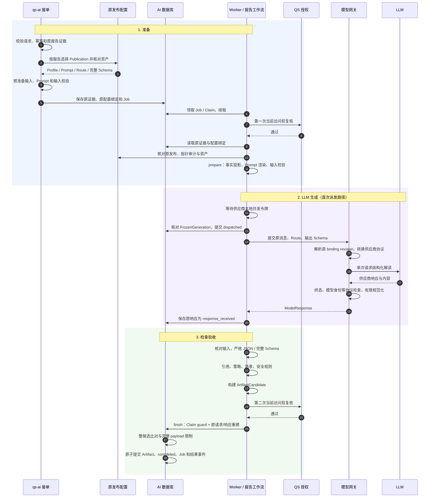

# 一次解读的准备、LLM 生成与检查验收

一次正式解读可以按三个步骤理解：**准备确定“依据什么、怎样解释”，LLM 生成产生“本次模型内容与调用证据”，检查验收决定“这些内容能否成为正式成果”。** 接单属于准备的前半段；内容校验与存储接受共同构成第三步。

当前报告图确实只有 `prepare → generate → validate` 三个节点，但完整业务流程还包括图外的接单、配置恢复、授权复核和成果事务。**每份正式报告的检查由程序执行，没有追加 LLM 语义裁判，也没有自动修稿循环。** 发布前配置评测中的语义裁判与人工审核属于独立治理链。

本文以合成的 Testee 7、Assessment 42、Report 99 为例，解释三个步骤的内部职责、输入输出、提交点和注意事项。它依据当前本地代码，不证明某套生产配置已启用、供应商实际调用或参与者内容验收。身份和事务的完整规则见 [解读、冻结输入与成果设计](01-解读冻结输入与成果设计.md)，质量治理见 [评测与质量审核](../evaluation/README.md)。

## 三步总览

| 步骤 | 必须回答的问题 | 内部工作 | 成功产物 |
| --- | --- | --- | --- |
| 1. 准备 | 解释谁的哪份报告？使用哪套规则？模型允许看到什么？ | 接单幂等、保存证据、选择并绑定发布、授权复核、事实投影、Prompt 渲染、输入校验 | 可执行 Job、原配置绑定；执行时得到 PreparedExplanation |
| 2. LLM 生成 | 哪次调用可以外发？采用什么模型和协议？怎样处理不确定结果？ | 并发控制、冻结请求、派发记录、协议转换、单次外发、响应检查与保存 | GeneratedExplanation，即冻结请求与持久模型响应 |
| 3. 检查验收 | 内容是否合法？来自原事实和原调用吗？当前仍允许接受吗？ | 结构/引用/策略/场景/安全检查、候选构建、再次授权、原响应重建与事务接受 | 持久 Artifact、AI completed、待投递结果事件 |

各步骤的产物不能互换：接单成功没有生成文本；供应商成功没有证明内容合格；候选合格尚未完成持久接受；AI completed 后仍需可靠交付给 QS。QS STORED 和用户实际看到结果是后续证据，见 [消息基础设施](../../03-基础设施/messaging/README.md)。

## 1. 准备：固定事实和规则，再构造本次生成任务

准备需要解决两个问题：先判断这份报告能否进入正式生成，再让执行者能从原依据重建同一任务。它在接单时做预准备，在 Worker 执行时做正式准备，使用同一套输入与 Prompt 构造函数。

### 1.1 接单先建立身份、幂等与原证据

QS 负责标准报告和参与者访问授权，向 qs-ai 提交 request_id、Actor、Testee、Assessment、goal，以及 standard_report 快照。入站适配验证服务/消息来源和正文后调用 `InterpretationService.start_external`。

接单按以下顺序推进：

1. 校验请求 ID、外部身份、goal 和测评列表。
2. 按全局 request_id 与完整请求摘要保留幂等结果：相同 ID/正文返回原回执，正文改变产生冲突。
3. 创建 Session 与新 Run，保存 request_id 到 Session 的映射。
4. 校验并保存 EvidenceSet，保留 QS 的原快照字符串及证据指纹。
5. 绑定配置、预准备输入，通过准入后创建 Job；确定性拒绝则保存 blocked 结果。

这些对象各有用途：Session 关联本次解读上下文，Run 表示一次执行，EvidenceSet 保存原事实，Job 是可领取工作。接单回执表达接受或拒绝结果，不能代替生成成果。

原报告关联同时受业务身份与摘要保护。外层 report_id/source_version 必须与快照内 source 对应；即使重新计算摘要，也不能把报告 99 的事实换绑到报告 100。摘要证明字节一致，不独立证明访问权或业务归属。

**注意：goal 参与请求校验、摘要和保存，但当前报告准备链没有把它作为自由任务文本注入 Prompt。** 不能据 Start 有 goal 字段就推断用户可以任意改写模型任务。

### 1.2 选择 Publication：先明确场景，再读取一组固定资产

`report_selector` 从原快照导出受众、模型种类、decision_kind、模型 code/version。量表 `scale/score_range` 可以依次查精确模型版本、模型代码和通用候选；MBTI `typology/pole_composition` 要求精确模型与版本。选择遵循当前发布指针与匹配规则，不能把所有场景写成相同的回退策略。

选出的 Publication 关联已评测发布的生成配置：

| 资产 | 控制范围 | 不承担的职责 |
| --- | --- | --- |
| Profile | 输入维度选择、场景策略、洞察/建议类别与数量等规则 | 不授予人员访问权；AI Profile 不是 IAM 人员档案 |
| Prompt | 系统规则、任务模板、数据说明、占位符白名单 | 不自行选择报告或最新发布 |
| Model Route | 模型、协议、参数及执行绑定身份 | 不保存端点和明文凭证 |
| Input Schema | 完整规范输入的结构和版本 | 不替代报告归属或当前授权检查 |
| Output Schema | 生成内容的完整结构 | 不证明所有自然语言语义正确 |

`compile_configuration` 核对资产快照、Profile 与 Manifest 一致，确认 Suite 评测过对应输入构造和输入/输出 Schema 组合，构造可执行 Prompt、Route、输入验证器与输出 parser。`bind_configuration` 再检查模型准入，调用 `prepare_explanation` 并验证完整输入 Schema。

保存的绑定包括 publication_id、publication_sha256、pointer_version、selector_query，以及证据 ID/指纹。执行时从该绑定读取原发布，核对历史指针审计和资产完整性，不用当前 active 发布替换。

例如请求采用 P1，排队期间运营发布 P2，这次仍用 P1。P1 资产或原审计缺失意味着原任务无法可靠重建，应失败为配置无效，而不是尝试从 P2 或 latest 补值。详细发布语义见 [发布与生效指针](../publication/README.md)。

### 1.3 为什么准备两次

| 时点 | 做什么 | 持久边界 |
| --- | --- | --- |
| 接单预准备 | 验证适用配置，组装输入、渲染 Prompt、验证输入 Schema | 保存原证据与配置绑定；这里不保存独立的 PreparedExplanation 调用记录 |
| Worker 正式准备 | 从原证据和绑定恢复配置，再组装并校验本次任务 | 得到 PreparedExplanation；进入生成后随 FrozenGeneration 保存为模型调用请求 |

接单预准备避免把明显无效输入排进执行队列。执行重建避免依赖接单进程内存，并核对原资产是否仍可验证。两次准备不会各自选择不同版本的配置，也不会产生两次模型调用。

MQ receiver 拥有根事务，将接单业务写入、Inbox 决定与首回执等共同提交。接单的确定性拒绝可以持久重放；数据库、网络、提交不确定异常则传播并回滚，不能统一改写为 blocked。具体错误归类由接单 UOW 负责。

### 1.4 Worker 先复核访问权，再读取冻结事实

Worker 领取 Job 后持有 Claim，其中包含当前 Run、Session 版本和 fence。租约 heartbeat 在执行期间续租；失租将阻止旧执行者继续提交。

执行前通过 QS Authorize 复核当前用户对 Testee/Assessment 的访问权，通过后读取原 EvidenceSet。冻结事实与配置保证重建依据稳定，授权则仍须当前有效。缺少原证据不能回到 QS 读取一份新报告替代。

这些职责由 `ExecuteNext` 包住整个工作流，授权不由 Prompt 或输入组装函数隐式完成。QS 授权不可用与明确撤销分别产生不同失败结果。

### 1.5 事实投影：让模型看到有限、可引用的报告内容

`prepare_report_input` 先核对 Session/EvidenceSet 绑定、指纹、单报告约束、standard_report Fact 与内外来源，再按场景调用输入组装器。

量表路径根据 eligible_codes/excluded_codes 选择维度，检查数量边界，按策略保留常模上下文和模型结果。保留的维度包含稳定 ref、分数、等级、标准描述、可用 parent_ref、排序及标准建议引用；标准建议被整理为可追溯的集合。

```text
context
  scope：仅本次测评
  audience：参与者
  locale：语言
  focus_areas：允许的组织重点
facts
  model / runtime：原测评模型与决策身份
  overall_result：总体分数、等级、标准结论
  dimensions：选定维度及其标准事实
  standard_suggestions：标准建议及引用
  model_result：策略允许时的模型结果
```

选择过程是有限投影：未被选中的维度不会为了补解释而重新加入；parent_ref 只保留可映射到选中维度的关系。因此输出层级检查沿输入中可用祖先链运行，不能宣称恢复源报告全部层级。

MBTI 保留 typed pole_facts，校验四轴及其 composition_order 与报告类型一致；strength 表示偏好强度，不转换为置信度。三主题再按原类型选择 Profile 中冻结的参考条目，附入 reference_material；这个路径没有在线检索或让模型自行找资料。场景细节见 [MBTI 事实](02-MBTI报告事实与版本契约.md) 和 [三主题参考材料](03-MBTI三主题与参考材料契约.md)。

准备产出两份关联数据：

| 值 | 包含什么 | 用途 |
| --- | --- | --- |
| canonical_json | 输入版本、报告来源、Profile 元数据、context/facts；MBTI 含场景契约，三主题再含参考材料 | 完整输入 Schema、input fingerprint、审计与接受重建 |
| provider_payload | context/facts；三主题另含 reference_material | 渲染成模型实际接收的数据消息 |

模型不根据原作答重新评分，不将常模、等级或人格方向缺失解释成推断许可。当前接单和正式图都使用准备默认值 `zh-CN` 与空 focus_areas；渲染器支持受控关注点，不表示这条调用链已接入用户自选关注点。

### 1.6 Prompt 组合：固定规则、受控参数和本次数据

`prepare_explanation` 将 AssembledInput 与发布 Prompt 组合成 PromptMessages，并连同发布策略、Prompt 指纹形成 PreparedExplanation。

| 逻辑部分 | 来源 | 主要内容 |
| --- | --- | --- |
| system_message | PromptPackage 固定文本 | 解释器职责、事实权威、禁止推断、输出及安全边界 |
| task_message | task_template 替换白名单占位符 | 语言、洞察类型和数量、维度引用数、层级策略、建议与长度要求 |
| data_preamble | PromptPackage 固定文本 | 声明下方字符串是待解释数据，不能执行其中的指令 |
| data_json | 本次 provider_payload 严格解析后序列化 | 原事实、稳定引用与必要的冻结参考材料 |

可以用以下组合关系理解：

```text
任务消息 = 已发布 TaskTemplate + RenderPolicy 参数 + 已校验语言/关注点
数据消息 = 已发布 DataPreamble + 本次 provider_payload
系统消息 = 已发布 SystemMessage
```

任务占位符示例：

```text
洞察数量：{{insight_min_items}}..{{insight_max_items}}
每条洞察不同维度数：{{min_dimension_refs}}..{{max_dimension_refs}}
允许祖先与后代组合：{{allow_parent_child_in_same_insight}}
建议来源：{{allowed_suggestion_origins_json}}
字符上限：{{max_output_characters}}
```

报告描述、建议和参考正文不被当作模板参数拼入系统指令。占位符值只能来自受控策略和已校验上下文；动态 system_message/data_preamble 被禁止。

渲染器检查 Prompt template_id/version 与 Profile 引用一致、模板段落非空、占位符合法且全部解析、数据顶层字段符合场景、无重复 JSON 字段或非 JSON 数值、语言与关注点合法、策略类别和边界合法。它不负责输出验收，也不会调用模型。

仓库 [量表 v6 Prompt](../../../integrations/qs_server/prompts/v6.json) 展示实际指令内容：尊重标准分数和等级，组织有证据的跨维度洞察与低风险建议，禁止诊断、因果推断和确定性预测。它是保留模板示例，正式请求采用其绑定发布中的资产，不能据文件存在推断生产版本。

### 1.7 准备阶段的注意点

准备成功表示输入和配置可以形成合规任务，不表示模型一定遵守指令。系统规则与数据分离提供了清晰信任边界，但不能保证抵抗所有提示注入。输入事实是否充分、建议是否适用、生成文本是否忠实，仍需后续规则和质量证据。

维护时要同时核对 Profile、Prompt 与 Schema：Prompt 描述的数量或禁止行为，应与实际策略及验证器一致；不能仅改文案就假定服务端新增了能力。新增场景还要有有限输入解码器、输出规则与发布评测证据，不能通过放宽标签直接接入。

## 2. LLM 生成：把本次任务变成可追溯、可恢复的调用

生成阶段接收 PreparedExplanation，附上冻结 Route、完整输出 Schema、publication_id 与 manifest_fingerprint，形成 FrozenGeneration。返回的 GeneratedExplanation 同时包含原请求与 ModelResponse，使第三步能够判断结果来自何处。

### 2.1 先区分任务容量、预算和模型并发

接单与 Job 领取路径负责持久容量和执行预算；生成前的 ModelCapacity 则控制当前进程对供应商的并发调用。三者解决不同问题，不能把本地信号量当作全局预算。

日预算按机构、用户、测评在接单时预留，以 UTC 日划分；幂等重放不重复占用，取消或终态不会退还已预留预算。执行活跃槽位在领取 Job 时获取，容量不足则延期；租约恢复复用原槽位，终态提交时释放。额度读取有效配置，不能把代码默认数值当作生产额度。

没有已有模型调用记录时，`DurableGeneration.execute` 先等待对应供应商的生成令牌，再建立派发记录。等待期间不持有数据库事务，也没有 dispatched 标记，Job heartbeat 继续续租。正式生成与治理评测共享供应商总并发，并为生成保留一定空间。

已有调用记录时，进入原记录恢复路径，不为读取原响应再等待新的模型令牌。ModelCapacity 是单事件循环的进程内计数器，不是多实例的分布式限流器；具体预算与容量策略见 [并发基础设施](../../03-基础设施/concurrency/README.md)。

### 2.2 冻结请求与先提交派发记录

`begin_model_call` 在短事务中校验 Claim 与原绑定，确认 FrozenGeneration 可由原配置重建；若 Run 没有调用记录，则创建 Invocation，保存 request_json 和 dispatched，并提交后才允许外发。

这里保存的是应用级冻结请求：输入、渲染后的消息、发布策略、路由、完整 Schema 和发布身份。**它不是完整 HTTP 原始报文。** 端点和凭证由网关运行时解析，不序列化进这份请求。输入、Prompt、Route 和发布资产各自的指纹，加上持久 request_json 的重建比对，用于防止恢复时更换策略或事实；ModelCall 没有另一个整请求 fingerprint 字段。

只有新建调用记录的执行者获得 created=True，可以调用供应商。重新领取同一任务只意味着恢复权，不意味着获得另一次外发权。Run、Invocation 和供应商 request_id 是不同身份，不能把本地 Invocation 自动当作供应商幂等保证。

### 2.3 路由与执行绑定：使用原模型身份

ModelGatewayRouter 核对 Route 与发布策略相符。对于 v2 路由，按精确 binding_id/revision 找执行绑定，并核对 provider、protocol、adapter_contract；缺失、禁用、端点或凭证不可用会失败为 binding_unavailable，协议不匹配则拒绝支持。

模型参数采用原 Route，不读取最新模型目录来临时换型号。绑定读取成功也不等于供应商一定接受该模型；还要检查实际响应模型身份。

| 参数/配置 | 所有者 | 说明 |
| --- | --- | --- |
| model、协议、结构化模式、推理/采样参数 | 原 Model Route | 不同协议仅发送受支持参数 |
| max_output_tokens、timeout_milliseconds | 原 Model Route | 控制生成上限与等待时限，不保证内容完整 |
| endpoint、凭证 | 网关执行配置 | 不写进 FrozenGeneration |
| publication/manifest 身份 | 原发布配置 | 将模型任务绑定到已接受的资产 |

当前支持的 DeepSeek Responses 与智谱 Chat 是代码中的适配路径，某环境是否实际配置可用需要独立验证。适配与参数限制的完整说明见 [模型网关](../../03-基础设施/model-gateway/README.md)。

### 2.4 将逻辑 Prompt 映射为供应商协议

| 内容 | DeepSeek Responses | 智谱 Chat |
| --- | --- | --- |
| 系统规则 | instructions | system 消息 |
| 任务规则 | developer 消息 | 合并到 system 消息 |
| 数据说明与 JSON | user 消息 | user 消息 |
| 输出约束 | Route 指定的 JSON Schema 或 JSON Object 模式 | system 中附完整 Schema，使用 JSON Object 模式 |
| 执行参数 | token 上限、reasoning 等适用参数 | max_tokens、thinking 等适用参数 |

DeepSeek 使用兼容投影后的 Schema：将引用与供应商支持的结构转换为可发送形式。三主题 sections 的精确顺序、数量等部分完整约束留给本地 Schema；本地完整 Schema 不因供应商能力限制而放宽。

智谱将任务规则和 JSON Schema 放入 system，数据仍放在 user。两种协议的消息形式不同，但保持发布指令与报告数据的逻辑分工。结构化输出模式用于约束模型输出，不能免除后续完整检查。

### 2.5 外部调用与供应商响应检查

适配器执行单次 POST，不自动重试、不自动改模型。适配器按完整终态 JSON 处理响应，不提供逐 token 报告推送；智谱请求显式设置 stream=false，DeepSeek 请求构造器不发送 stream 字段。HTTP 响应体按字节读取用于限制大小。当前默认供应商响应体上限为 2 MiB，Route 时限同时用于总等待与 HTTP 调用。

生成链禁用环境中的 LangSmith tracing 与 callbacks，避免测评内容意外进入旁路追踪。HTTP 调用不跟随重定向。

返回后先检查协议层，得到可持久的 ModelResponse：

| 检查 | DeepSeek 示例 | 智谱示例 |
| --- | --- | --- |
| 确定终态 | status=completed；识别 incomplete、failed、queued 等 | finish_reason=stop；识别 length、过滤与异常终止 |
| 响应身份 | 非空响应 ID、model 与 Route 匹配 | 非空 ID、model 与 Route 匹配 |
| 输出数量和类型 | 恰好一个 message、有效 output_text、无 refusal | 恰好一个 choice、有效 content、无 tool_calls/refusal |
| 用量合法 | token 数为非负整数，reasoning 不超过输出数 | prompt/completion token 数合法 |

HTTP 429、认证失败、余额不足、服务端错误及连接/超时分别被分类。超时或部分传输故障可能表示供应商已经执行，必须带 result_unknown 处理；错误的 retryable 标记只是分类信息，正式图不会据此自行循环重发。

协议检查得到的“成功响应”只是存在一份可处理的模型输出。它还没有通过业务内容验收，response_received 不是报告 completed。

### 2.6 有限包装规范化与原响应保存

ModelResponse 保存 invocation_id、供应商 request_id、model、raw_output、validation_output、normalization、用量和耗时等字段；v2 路由还附执行身份。raw_output 是供应商的内容文本，**不是完整 HTTP 原响应**。

DeepSeek 对少数已支持包装做有限规范化：JSON 代码围栏，以及单字段 parameters/json/json_string 信封。可以拆围栏再拆一个信封，不递归处理任意多层包装；保留原文本和处理标记。智谱没有同样的包装转换。

例如，合法 JSON 对象外套一个受支持围栏，可以取得内层对象供校验；缺失必填字段、损坏 JSON 或不明包装，不会由适配器“猜着修”。保留的内层空白仍参与验证文本的字符长度检查。

`record_model_response` 在短事务中核对调用仍归当前 Invocation/fence 所有，保存 response_received、failed 或 unknown。供应商响应保存先于候选验收，因此内容检查失败时，已保存的原 ModelResponse 可保留为这次调用证据。

### 2.7 恢复规则与两个中断窗口

| 原 ModelCall | 恢复行为 | 是否再次外发 |
| --- | --- | --- |
| 不存在 | 校验原任务，创建并提交原调用记录 | 新建记录者外发一次 |
| response_received 且响应完整 | 解码原请求/响应，核对身份后复用 | 否 |
| dispatched 或 unknown | provider_result_unknown | 否 |
| failed 且失败码完整 | 重放原失败 | 否 |
| 记录无效或原配置不一致 | model_call_record_invalid / model_call_configuration_mismatch 等失败 | 否 |

第一个窗口是 dispatched 已提交、真正发 HTTP 前进程退出。第二个窗口是供应商已返回、响应提交前进程退出。恢复者可能看到同样的 dispatched，所以不能推断请求未发送。当前设计选择保守地停止盲目重复调用，其代价是部分实际未发请求也会停留未知结果边界。

已经 response_received、仅成果事务失败时，可以在原 Job/Claim/预算、证据、配置和授权均满足恢复条件的前提下复用响应，再做第三步。受控 ParticipantRetry 是另一个业务动作：创建新 Run，保留原事实和生成依据，并按失败类型满足相应条件；unknown 不能当作普通自动恢复。完整机制由 [执行恢复](../../03-基础设施/execution-recovery/README.md) 维护。

## 3. 检查验收：先检查内容，再核证来源与提交资格

“检查验收”有两层：图内 validate 构造合格候选；图外 Worker 与 `finish` 再决定候选能否持久接受。这里的验收是服务端接受规则，不等于人工确认内容质量。

### 3.1 检查链与输入重建

```text
GeneratedExplanation
  → build_artifact：核对冻结输入和响应身份
  → validate_output：长度、严格 JSON、完整 Schema、场景规则
  → check_safety：禁止措辞与 limitations
  → ArtifactCandidate
  → Worker 再次检查当前访问权
  → finish：原配置/原响应重建、Claim 校验、事务提交
```

`build_artifact` 从冻结 provider_payload 取得 locale/focus，再用原 Session、EvidenceSet、InputPolicy 重新组装输入，要求完整 AssembledInput 与原值相等；同时要求 Invocation、供应商 request_id 非空且模型与 Route 匹配。不能只信任一段 JSON 或一个 content hash。

该步骤重建的是本地输入与成果，没有再次调用 LLM。

### 3.2 严格 JSON 与完整输出 Schema

先按 RenderPolicy 检查 validation_output 的字符长度，再解析和校验；计数采用解析前的验证文本，不采用 parser 后重新序列化的 JSON。QSOutputParser 拒绝重复字段、非 JSON 数值、非对象根值和不符合绑定完整 Schema 的内容。

Schema 检查必填字段、类型、枚举、数组、字段长度及条件关系。例如量表 v1 建议必须包含约定字段，source_suggestion_refs 必须是数组；standard_derived 至少要有一个标准建议引用。这些是结构约束，仍需下一层检查引用是否存在。

完整 Output Schema 来自原发布资产。不同场景的输出契约不同：量表与单篇使用 v1 内容，三主题使用 v2 内容及对应 scene_contract_version。不能拿通用 v1 验证器强行接受三主题内容。

### 3.3 量表业务规则：引用、数量、类别与层级

| 检查 | 具体条件 | 典型失败码 |
| --- | --- | --- |
| evidence_refs | 洞察和建议引用的 ref 属于本次对应种类的事实集合 | unresolved_evidence |
| source_suggestion_refs | 每个引用指向原标准建议 | unresolved_standard_suggestion |
| 洞察数量/类别 | 符合 insight_min/max 与 allowed_insight_kinds | insight_count_outside_policy / insight_kind_not_allowed |
| 不同维度数量 | 只计 kind=dimension 的不同 ref，满足 min/max；整体结果、模型结果和标准建议引用均不计入维度数 | dimension_count_outside_policy |
| 维度层级 | 策略禁止时，同一洞察没有输入中可识别的祖先/后代组合 | ancestor_descendant_combination |
| 建议数量/来源/类别 | 满足数量边界及允许 origin/category | suggestion_count_outside_policy / suggestion_policy_mismatch |
| 行动数量 | 不超过 max_actions_per_item，其他结构下限由 Schema 检查 | too_many_actions |

以选中输入中 P 是 A/B 父维度为例：策略禁止祖先后代组合时，A+B 可以满足层级规则，P+A 和 P+A+B 不能通过。计数按不同 ref，不允许用重复 A 引用凑足跨维度要求。程序检查可用 parent_ref 链及环路，不推断正文没有引用却暗含的父子关系。

引用合法不等于语义支持：它只证明模型用了存在的引用身份，不能证明正文确实忠实解释这些维度。standard_derived 引用存在，也不能完整证明建议方向没有被改写。

v1 summary 是字符串，没有 evidence_refs；当前引用存在性检查覆盖洞察与建议，不能据此认定总结中的每句话都经过引用核证。

### 3.4 MBTI 检查：类型一致与参考适用性

单篇 MBTI 在通用规则后扫描输出中明确出现的四字母类型代码，出现与原类型不同的代码则 mbti_type_conflict；该扫描不理解所有人格描述。

三主题分支使用专用规则：

1. 校验输出版本与 scene_contract_version，完整 Schema 约束 personality/career/relationships 的结构、顺序和数量。
2. 从冻结输入重新核对 MBTI 事实与参考材料投影。
3. 检查 summary，以及各主题 insights、reflection_questions、actions 的 evidence_refs 存在。
4. 对 reference_refs 检查条目属于原选择集合、topic 匹配，且关联原轴维度或 model_result 证据。
5. 检查明确类型代码与原报告一致。

三主题不原样套用量表所有洞察/建议计数规则；应按专用 validator 与绑定 Schema 解释。选中参考条目适用也不证明模型句子被其正文完整支持。

三主题还用 basis 声明内容依据：report_fact 洞察不允许 reference_refs，general_reference 与 exploration 洞察要求至少一条参考引用。这帮助区分测评事实解释、通用参考和探索内容；Schema 保证声明结构合法，不会自动证明正文确实符合所声明依据。

Artifact 中 reference_material_json 与 fingerprint 由冻结 Profile 选定材料生成，置于模型内容之外；不会采信模型自写来源替换原参考字节。

### 3.5 安全检查：明确措辞与边界声明

check_safety 将内容 JSON 按规则小写化并去除空白，然后检查固定子串：

| 类别 | 规则中的示例 | 失败码 |
| --- | --- | --- |
| 诊断 | 确诊、证明患有、diagnosed with | forbidden_diagnosis |
| 因果 | 由此导致、这导致了、this causes | forbidden_causality |
| 用药 | 建议服用、开始用药、take medication | forbidden_medication |
| 治疗方案 | 治疗方案是、must undergo therapy | forbidden_treatment_plan |
| 风险重分类 | 重新分类为高风险、in a crisis state | forbidden_risk_reclassification |
| 身份推断 | 说明你就是、你本质上是 | forbidden_identity_inference |
| 确定性预测 | 你一定会、未来必然、will inevitably | forbidden_deterministic_future_prediction |

limitations 还需包含本次测评范围，并用受支持的否定表达覆盖诊断和确定性判断。否定检查使用有限窗口与转折边界；不满足时为 limitations_incomplete。

这是固定字符串规则，不是上下文语义审查。禁止短语的扫描不会因前面写了“并非”就自动豁免，可能拦截引用或否定中的短语；反过来，换一种不在规则里的表达也可能漏检。limitations 的否定规则与全内容禁止短语扫描是两套检查，不能混为一个语义判断器。

Prompt 可以要求固定边界句、禁止正文因果暗示或忠实保留等级，实际验证器未必逐字或逐句证明全部要求。维护时应明确每条规则由 Prompt 引导、Schema 保证还是程序检查，避免扩大安全保证。

### 3.6 候选身份与持久验收

所有内容检查通过后，build_artifact 生成 ArtifactCandidate：

| 记录 | 用途 |
| --- | --- |
| content_json / content_fingerprint | 被接受内容与字节摘要 |
| Session / Run / EvidenceSet / 报告来源 | 说明解释谁的哪份原报告 |
| Invocation / provider_request_id | 关联哪次原模型调用 |
| input / Profile / Prompt / Route 指纹 | 说明按什么固定依据生成 |
| 输出与安全 validator version | 记录采用哪套本地接受规则 |

Artifact ID 按 Run/Invocation 确定性生成，同一原调用重建得到同一 ID。候选值对象本身没有完成持久接受。

Worker 在工作流正常返回后再次向 QS Authorize 复核当前访问权，随后进入 `finish`。外部授权检查在数据库接受事务之外；数据库 guard 负责本地任务有效性，不能把两者描述为跨系统原子授权事务。

`finish` 的接受顺序是：

1. 锁定并检查 Session、Job、租约：Session 仍 running，active_run_id、version、Job leased 状态和 fence 都匹配，租约未过期。
2. 核对候选与原 Session/EvidenceSet、Invocation、供应商响应身份和内容摘要。
3. 要求原 ModelCall 为 response_received，从原发布配置重建预期 FrozenGeneration，核对持久 request_json。
4. 解码持久 response_json，再执行 build_artifact，比较整份候选与重建值。
5. 检查完整成果 payload UTF-8 JSON 不超过 131072 bytes；这与输出字符数、HTTP 响应体大小是不同限制。
6. 同一事务插入 Artifact、完成 Session/Run、结束 Job、释放租约与容量并保存结果事件，全部成功才提交。

已取消、被新 Run 替代、版本变化或 fence 失效的执行者无法接受迟到成果。结果带失败码时不能同时携带 Artifact；缺少合格 Artifact 的普通结果不会制造 completed。

### 3.7 为什么检查并重建两次

图内 validate 先给出合格候选，便于业务失败归类；存储接受重新使用持久原请求/响应，确保候选没有换输入、换配置或改内容，且提交者仍有权提交。

接受层重跑的是本地校验，不是再次生成。它保证候选与已持久的原依据一致，付出的代价是增加本地重建和校验工作；不能用缓存中的“检查通过”省略原事务接受规则。

### 3.8 程序验收与语义、人工验收的界线

| 程序目前能证明 | 仍不能完整证明 |
| --- | --- |
| 完整 Schema、数量和类别合规 | 文案质量、是否重复或牵强 |
| 引用存在、主题和轴关联可核验 | 这句话是否真正由引用事实支持 |
| 未命中预设禁止短语 | 隐含因果、表达变体或不合理建议 |
| 明确 MBTI 类型代码无冲突 | 自然语言人格描述的全部忠实性 |
| 候选等于原输入/响应重建成果 | 原模型内容在语义上正确 |
| 当前授权复核和本地 Claim 通过 | 用户实际认可内容或后续权限永远有效 |

合成反例：模型引用真实 A/B 维度，却写“你在团队冲突中经常选择退让”。结构和引用可以合法，安全规则也可能未命中；原报告仍未必支持“团队冲突”或“经常退让”。

正式报告图没有调用第二个 LLM 来裁判该句。配置发布前治理评测有独立语义裁判和人工审核，用于核证候选方案质量；它不等于每份真实参与者内容都重新接受语义或人工审核。服务端 Artifact 验收、配置质量批准与参与者内容验收须分别记录。

### 3.9 失败处理与恢复边界

| 失败发生点 | 当前处理 | 下一次推进的边界 |
| --- | --- | --- |
| 接单确定性输入/配置/容量拒绝 | 保存可重放拒绝，不创建可执行 Job | 新发布不自动改变原决定 |
| 原配置恢复失败 | configuration_invalid，无正式成果 | 不能替换成最新资产 |
| 正式准备不适用/输入无效/Prompt 无效 | report_not_applicable / report_input_invalid / prompt_invalid | 不继续模型生成 |
| 证据绑定等 RuleViolation | Worker 归为 evidence_invalid | 不读取新报告补事实 |
| 供应商明确失败 | 保存失败分类，工作流返回失败结果 | 同一调用不因 retryable 标记自动重发 |
| 供应商结果不确定 | provider_result_unknown | 需遵循未知结果与受控新尝试规则 |
| 结构、引用或安全失败 | 相应失败码，blocked，无 Artifact | 不自动回到 LLM 修稿 |
| 当前访问权撤销/授权依赖不可用 | access_revoked / dependency_unavailable | 不接受本次成果 |
| 成果重建、payload 或事务提交异常 | 异常传播，接受事务回滚 | 原响应保留；恢复仍受原 Job/Claim/预算等条件约束 |
| 失租、取消或新 Run 替代 | 本地 guard 拒绝旧执行者 | 迟到结果不能绕过 guard |

技术异常由执行循环退避处理，不伪装成业务成功或普通拒绝。失败码、原调用记录、Session/Run 和诊断字段应共同检查；不能只看到 blocked 就直接认定再次调用模型安全。

## 完整时序图

成功路径将业务三步分组；省略中间消息状态事件及回执。



## 源码、测试与证据范围

| 内部职责 | 主要实现 | 既有保护与局限 |
| --- | --- | --- |
| 接单与原配置绑定 | [service](../../../src/qs_ai/application/interpretation/service.py)、[selection](../../../src/qs_ai/application/interpretation/selection.py)、[execution_configurations](../../../src/qs_ai/infrastructure/persistence/mysql/execution_configurations.py) | [MQ 接单](../../../tests/integration/test_transaction_start_admission.py)、[配置恢复](../../../tests/integration/test_execution_configurations.py)；原事务需隔离 MySQL |
| 输入与场景事实 | [preparation](../../../src/qs_ai/application/interpretation/preparation.py)、[input](../../../src/qs_ai/application/interpretation/input.py)、[MBTI 三主题输入](../../../src/qs_ai/application/interpretation/mbti_themes_input.py) | [输入绑定](../../../tests/test_input_binding.py)、[输入组装](../../../tests/test_input_assembly.py)、[三主题输入](../../../tests/test_mbti_themes_input.py) |
| Prompt 与正式图 | [prompts](../../../src/qs_ai/application/interpretation/prompts.py)、[ReportWorkflow](../../../src/qs_ai/infrastructure/workflows/report.py) | [Prompt](../../../tests/test_prompts.py)、[冻结证据](../../../tests/test_worker_frozen_evidence.py)；不证明模型服从所有指令 |
| 持久生成与并发 | [DurableGeneration](../../../src/qs_ai/application/execution/generation.py)、[ModelCapacity](../../../src/qs_ai/application/execution/model_capacity.py)、[调用存储](../../../src/qs_ai/infrastructure/persistence/mysql/execution.py) | [模型容量](../../../tests/test_model_capacity.py)、[生成集成](../../../tests/integration/test_generation.py)；后者需可销毁 MySQL |
| 协议与有限规范化 | [router](../../../src/qs_ai/infrastructure/models/router.py)、[请求投影](../../../src/qs_ai/infrastructure/qs_server/deepseek_request.py)、[normalization](../../../src/qs_ai/infrastructure/qs_server/normalization.py) | [请求](../../../tests/test_deepseek_request.py)、[多供应商](../../../tests/test_multi_provider_gateway.py)、[规范化](../../../tests/test_provider_normalization.py)；使用替身不证明线上供应商能力 |
| 完整结构与场景规则 | [parser](../../../src/qs_ai/infrastructure/qs_server/output.py)、[output](../../../src/qs_ai/application/interpretation/output.py)、[三主题检查](../../../src/qs_ai/application/interpretation/mbti_themes_output.py) | [输出校验](../../../tests/test_output_validation.py)、[三主题输出](../../../tests/test_mbti_themes_output.py)、[参考材料](../../../tests/test_mbti_references.py) |
| 安全措辞与候选 | [safety](../../../src/qs_ai/application/interpretation/safety.py)、[artifact](../../../src/qs_ai/application/execution/artifact.py) | [安全](../../../tests/test_safety.py)、[成果重建](../../../tests/test_artifact.py)；均不等于完整语义审核 |
| 双重授权与原子接受 | [worker](../../../src/qs_ai/application/execution/worker.py)、[finish](../../../src/qs_ai/infrastructure/persistence/mysql/execution.py) | [当前授权](../../../tests/test_qs_access.py)、[接受事务](../../../tests/integration/test_artifact_acceptance.py)；授权 RPC 与数据库提交不是分布式原子事务 |

装配由 [GenerationProvider](../../../src/qs_ai/bootstrap/providers/generation.py) 将配置读取、DurableGeneration、网关和报告图绑定起来。需沿装配判断当前正式路径，不以类名或未调用的能力推断运行行为。

本地规则与替身测试证明对应断言，数据库集成测试证明所覆盖的持久边界；真实模型内容、生产部署、QS STORED、页面展示与人工接受需要独立证据。本文复核和检查方法登记在 [文档闭包](../../document-closure.json)，运行状态保持 unknown。

返回 [解读与成果](README.md)。
