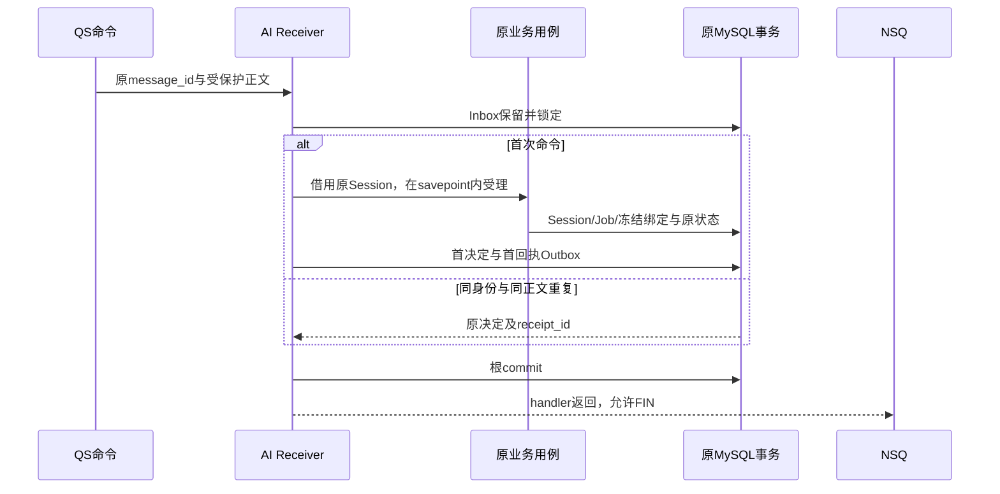

# 消息接单、Outbox 与业务确认

qs-ai 通过消息受理命令，把可见状态和成果作为持久事件交给 QS。一次本地提交证明“业务效果与待发消息同时存在”；Broker 的发布确认成功证明 Broker 接收；QS 对原事件返回 `STORED` 才证明其接收事务完成。这三个完成点分别有记录，不能合并成一个“发送成功”。

本文以一次 Start 产生 Session、最终形成 Artifact 并交付 QS 为主线。核对基线：qs-ai `d9c3155`，QS `2ccc2de44`，2026-10-06。上述日期记录原业务链路；2026-10-19 的 M3 接入基础固定依赖 `fangcun-reliable-messaging[nsq,rocketmq]==0.4.0a1`（SDK 源码 `bfaae2b82ee0d1229b8c965fce472cdf5dec486f`）。业务尚未切换事务入口，测试、部署与真实业务接收仍是独立证据。

## RocketMQ 普通消息

`messaging.provider=rocketmq` 显式选择普通消息；默认仍为 `nsq`。RocketMQ endpoint、私有凭据、CA 与 version1 逻辑/物理路由清单由宿主冻结并只读挂载到 `/run/qs-ai-rocketmq/`。Python 的 `GRPC_DEFAULT_SSL_ROOTS_FILE_PATH` 必须在进程启动前绑定同一 CA。Docker 部署脚本与离线 preflight 校验路径、权限、内容摘要与路由，SDK 不发现生产配置或创建资源。

运行时复用当前应用循环和数据库，SDK 在显式 start 时创建客户端及有界 blocking-driver executor。客户端实际取得路由和服务端 settings 后才报告启动完成。普通消息不会改变原命令 Inbox、Outbox、本地事务、业务回执、冻结配置和 unknown 模型调用的恢复规则。`publish_enabled=false` 在 Relay 扫描前暂停，避免维护期间消耗发布预算。

RocketMQ 终态交接携带 provider、原始 Wire 和实际物理来源，宿主仍先验证受保护的原命令或 ACK，再提交原持久失败记录，成功后才允许消费 ACK。NSQ 的 failure topic 中转只用于 NSQ 分支。当前业务尚未接入事务发送器，发布型 Outbox 继续存在。源码与测试通过不代表生产已经切换，生产版本、有效绑定和 `system` 账号业务验收需独立记录。

## M3 事务装配基础（业务接入进行中）

[`transaction_messaging.py`](../../../src/qs_ai/bootstrap/transaction_messaging.py) 提供独立的 `make_transaction_sender` 和 `TransactionRuntime`，借用宿主 primary `async_sessionmaker`，构造不创建 session、线程、客户端或表。必须显式配置 `messaging.transactions["ai.mysql"]` 的 `store_id`、`writer_epoch`、`route_revision=m3-1`，并校验同一可信 CA。v2 manifest 中只选择本 owner 的 TRANSACTION 事件路由；v1 不得夹带 v2 字段。

默认发送并发 4、Checker worker 1 / 等待队列 16，DB 回查 2 秒、RPC 5 秒、lease 60 秒、每 5 秒最多维护 100 条；覆盖预算必须给出全部九个字段。`publish_enabled=false` 只封新发送并保留 Checker；最终关闭通过 StopAdmission / Close / Wait 排空 SDK，然后由宿主关闭 DB 和 loop。`ShutdownIncomplete` 原样保留，不能当作成功关闭。

宿主迁移 `0041_transaction_messaging` 显式安装独立 schema v1；owner binding 必须由冻结清单另行安装，不由构造/Start 推断。Down 保留证据并拒绝回退；隔离原事务安装测试见 `tests/integration/test_transaction_schema.py`。

此入口目前未接入 command admission、状态 finalization 或统一 server。旧 `MessagingRuntime.create()` 遇到非空 transactions 明确拒绝，避免继续由 MQRelay 发送事务 owner 的消息。原根事务、首 wire、业务 receipt 和模型 unknown 恢复仍按下文执行；后续批次逐项替换，不因 SDK 具备事务能力就宣称业务已迁移。全局进度以 [infra M3 总表](https://github.com/FangcunMount/infra/blob/main/docs/server/rocketmq-m3-execution.md) 为准。

## command 冻结与原根执行器（生产装配尚未启用）

`transaction_command.py` 在认证和正文解析之后持有原始 command bytes，以 owner、组织、原 command ID 和稳定 input hash 标识请求。完整计划保存首次 receipt/state 的 ID、正文、wire 和 v2 路由。无本地上下文时 archive/v1 的 bytes 和摘要不变；带上下文时显式采用宿主 archive/v2，最多 16 KiB，上下文计入本地计划与消息指纹，原业务 wire 不变。SDK codec/schema 保持原版本。读取持久化赢家时，逐分支校验原 command、组织、路由以及业务 receipt/state 的版本和关联；同一计划所有分支的上下文必须相同。

[`AdmissionRoot`](../../../src/qs_ai/infrastructure/workflow_transport/transaction_admission.py) 是传给 SDK 的单次本地执行器：在宿主原根先取得 SDK guard，借用冻结的 Inbox reservation 身份，执行宿主业务 action，比较真实业务结果与冻结 receipt，再将 Inbox、全部首次档案和 witness 一同提交。HELD 不调用业务 action；旧 Inbox 不能被冒充为新 witness。事务入口的 Inbox 决策不新增旧 messaging_outbox 行。

该执行器不规划业务、不签名、不发送半消息，也不重试业务。根被替换、提交回复丢失或证据不足返回 Unknown；只有原根回滚完成且持久化中止成功，才返回 Aborted。回复丢失后的权威读取采用新 session 边界并有预算。SDK 继续分别报告本地结果与 Broker 最终确认。

`StartPlanFacts` 保存冻结时间、原 input hash、session/run/evidence/job/Inbox/state 身份及精确配置依据。它采用显式版本和规范 JSON，拒绝重复/未知字段、错误身份/证据及不一致 receipt/state；并发失败方必须读取赢家的事实，不能继续使用自己新生成的候选。`plan_configuration` 复用原配置解析和输入校验，只读生成绑定依据；原根 `bind_configuration(expected=...)` 锁定并核对 pointer、publication、evidence 后才写入。冲突不转换为业务拒绝。

解释业务与 SQL job 的身份、Inbox reservation 可以借用预分配值；历史入口默认分配行为不变。START 已提供只读 `ReadOnlyStartUnitOfWork` 和完整 `StartAdmissionPlanner`：复用原服务规则，预查幂等、配置和容量，读事务关闭后才冻结 receipt/state 首次 wire。执行时 `make_start_root` 从 reservation 赢家读取 `StartPlanFacts`，借用原服务与 SQL 根，重校验配置和 UTC 预算日，明确验证状态后再写 witness/提交；`EventSession.commit` 不再编排这次发送。状态历史仍保留必要拒绝证据并标记 MQ 责任，事务入口不创建 messaging_outbox 发布责任。已完成 Inbox 不能因 token 相同而再次取得业务执行资格。

两类评测命令已增加只读完整规划和原根装配，待新候选原生验证；实际 command receiver 装配和真实 Broker 验收仍待完成，旧 runtime 对 transactions 配置的拒绝继续保留。`tests/integration/test_transaction_admission_root.py` 提供两种宿主档案格式的隔离 MySQL HELD 根原子性、服务端拒绝和客户端丢弃已提交回复用例；`test_execution_configurations.py` 增加真实只读规划、匹配绑定及 pointer 冲突用例。候选80805fb的两档MySQL完整CI各3242项零失败/跳过，已下载核对八份分片覆盖；这是原根/配置与历史回归的证据。后续真实只读START、并发赢家、原业务+witness及显式Replan旧证据验证用例已加入，待新候选CI。它们仍不计为Broker、网络故障或完整业务链路验收。

## T17 独立状态冻结与原根基础（实施中）

T16 command 组件已合并并通过隔离原事务及固定发布 SDK/Broker 验证，统一生产装配仍保持关闭。下文的旧候选记录保留排查经过；当前任务、失败历史和验收状态只以 [infra M3 总表](https://github.com/FangcunMount/infra/blob/main/docs/server/rocketmq-m3-execution.md) 为准。

[`state_projection.py`](../../../src/qs_ai/infrastructure/workflow_transport/state_projection.py) 共享原解释/评测可见状态投影，不读取数据库、不创建 ID 或时间、不签名。原普通消息 recorder 与事务状态核验使用同一投影；同评测版本复用原 sequence，版本回退拒绝。

[`EvaluationStateIntent`](../../../src/qs_ai/infrastructure/workflow_transport/evaluation_state_plan.py) 为非 command 状态提供独立稳定请求。宿主必须提供原授权操作键、原 expected version 和稳定业务输入摘要，不能使用候选时钟、密文或会在提交后变化的当前业务行代替原输入。冻结事实保存首次 UTC 时间、前序 sequence/version；完整计划只接受精确 owner/组织/Run/目标版本/物理路由及原首次 wire。读取持久化赢家不需要密钥，不重新 Seal，也不借用 command Inbox。

[`EvaluationStateRoot`](../../../src/qs_ai/infrastructure/workflow_transport/evaluation_state_root.py) 从赢家组装单次本地执行器。SDK 负责先准备半消息；宿主原根第一条条件写取得 guard，然后原业务适配器重校验授权和业务条件、写业务事实。keyless 状态转录精确核验可见状态、竞争原 sequence CAS，再显式写档案/witness 并提交；`EventSession.commit()` 不编排该新状态。未完成或失败的转录也不得移动到另一个根事务。

command 与独立状态共用 [`commit_original`](../../../src/qs_ai/infrastructure/workflow_transport/transaction_root.py) 的根提交/新读取边界：提交回复不明只查询精确 witness，原根回滚且持久化中止成功才证明 Aborted；取消和连接错误不构成回滚证明。宿主继续持有连接池、业务条件和生命周期。新状态入口不创建旧发布 Outbox，不自动 Retry/Replan 或调用模型。

worker 预检通过显式 `preflight_dispatch` 借用 [`PreflightStateDispatcher`](../../../src/qs_ai/infrastructure/workflow_transport/evaluation_preflight_dispatch.py)。先按原 Run/version/组织及稳定操作键查询 SDK 请求；已提交的旧 hint 只核验首次证据，不因当前 checkpoint 已推进而重新规划。未决或中止记录需要精确证明或显式恢复，不自动创建新执行。

[`PreflightStatePlanner`](../../../src/qs_ai/infrastructure/workflow_transport/evaluation_preflight_state.py) 只读当前 Run/checkpoint、原登记 suite 与序号，关闭读取后再计算原无模型预检、生成身份和第一次 Seal。赢家上下文冻结首 PreflightEvidence、时间及源快照摘要；原执行器锁定并重新核验源，再调用原 preflight 完成规则。稳定请求输入和可变源快照分别保存，避免已提交重投因业务推进而误报输入冲突。

空业务上下文保持已有状态 facts/v1 的每个字节；非空预检上下文采用显式 facts/v2，原始操作上下文最多8 KiB，整个宿主上下文仍最多16 KiB。读取支持两个显式版本，SDK codec/schema及原业务 wire 不变。worker 的新入口只接受精确原根提交证明；`LocalCommitted + FinalUnknown`（含SDK结构化异常）保留Broker确认责任，不授权模型重做。默认装配继续保留原入口，事务运行装配须等待全部状态、ACK和历史责任接入。

原 [`prepare_step`](../../../src/qs_ai/infrastructure/persistence/mysql/evaluation_step.py) 的准备与 dispatch 会在一个根事务内连续推进两个 checkpoint 版本。独立状态计划允许冻结高于原 expected version 的最终版本，仍只递增一次消息 sequence、发布一条最终状态，不拆分原提交或发布中间版本。首次 wire、上下文 v1/v2 和 SDK codec 不变；原根转录仍精确比较最终数据库状态与冻结消息。

治理定稿与重开分别复用 [`finalized_progress`](../../../src/qs_ai/infrastructure/persistence/mysql/evaluation_finalization.py) 和 [`reopened_progress`](../../../src/qs_ai/infrastructure/persistence/mysql/evaluation_reopening.py) 的纯进度投影。宿主先取得有作用域的有效门槛快照；原事务继续持锁、重新验证门槛并提交。拒绝历史、首次审核和修正记录保持原规则。抽出投影不表示治理 RPC 已接入事务消息。

[`GovernanceStateOperation`](../../../src/qs_ai/infrastructure/workflow_transport/evaluation_governance_state.py) 冻结宿主已授权的定稿/重开操作、原版本、操作者、理由和明确确认。操作 ID 由宿主在数据库根事务外分配，不新增公共跨 RPC 幂等承诺。稳定业务输入摘要与可变源快照摘要分别保存；两者都绑定首次状态计划。

`GovernanceStatePlanner` 在显式 REPEATABLE READ 只读边界中复用原门槛/拒绝证据和纯投影，读取结束后才第一次 Seal。`GovernanceStateRoot` 在 guard 前设置同一隔离级别，在原根中锁定 Run/checkpoint、重验源快照和业务门槛，再提交状态、原审核历史、sequence、档案和 witness。构造不产生资源或 DDL；两种原治理操作仍不执行模型。原生验收用例现为12项，包含直接RPC处理函数及数据库原子性边界；数据库专用runtime不冒充SDK半消息或Broker证明，执行状态以infra总表为准。治理默认RPC装配与最终运行装配尚未切换。

[`GovernanceStateDispatcher`](../../../src/qs_ai/infrastructure/workflow_transport/evaluation_governance_dispatch.py) 先查原请求再规划/准备，使用持久化赢家并仅执行一次。只有精确 witness 和首次档案都证明原提交，才返回原根中取得的原响应；不读取今天的 Run 来替代该次响应。`LocalCommitted + FinalUnknown` 保留确认责任；原 CAS/业务错误只有在原根已证实 Aborted 时才能继续按原错误返回，未知结果不改写为冲突或授权业务重做。

[`TransactionalEvaluationManagement`](../../../src/qs_ai/infrastructure/workflow_transport/transactional_evaluation_management.py) 为定稿/重开提供显式管理适配器。原RPC处理函数继续校验QS工作负载、主体、版本和确认，服务端首次分配操作ID/时间；每个新RPC仍遵循原CAS行为，不新增公共幂等承诺。其余写入口继承原实现，因此默认容器/生产装配仍等待完整迁移，不能提前启用混合运行。

原 [`accept_reviews/plan_reviews`](../../../src/qs_ai/infrastructure/persistence/mysql/evaluation_reviews.py) 共享评审准入与投影。`plan_reviews(lock=False)` 仅使用宿主明确的 RR 只读快照，不推进 checkpoint、写业务或提交；原写入口仍先锁 checkpoint/Run，再写原 CAS 与审核事实。原 1–35 项、单项理由和语义评审边界继续有效，不因消息元数据预算缩小合法输入。只读规划和原写入口共享规则；[`ReviewStatePlanner/ReviewStateRoot`](../../../src/qs_ai/infrastructure/workflow_transport/review_state.py) 已提供显式评审事务入口，但默认生产装配仍未启用。相关真实 MySQL 用例执行状态以 infra 总表为准。

本批尚未替换全部 worker、治理和终态入口。MySQL 原状态根、实际 worker 及固定 SDK/Broker profile 分别验证；当前进度和失败记录回链 infra 总表，不据单项通过启用统一 runtime 或标记 T17 完成。

## 当前服务怎样装配这条链路

统一入口 `bootstrap.server.serve()` 要求 `messaging.enabled=true`；缺少时直接启动失败。配置模型的默认值仍为 false，意味着调用方必须显式绑定所选 Broker、JOSE 密钥和 QS mTLS 载荷端点，不会自动启用开发传输。旧 `bootstrap.integration` 入口已经退役，当前没有并行运行的 gRPC 结果扫描器。

`MessagingRuntime.create()` 取得应用的 `Database`，创建一个使用该池的 `Transactions`，先在只读一致快照中检查必需的技术观测表及类别，再安装 `database.state_events`。随后装配命令 receiver、两个订阅器、Publisher、载荷端点及一个 MQRelay。资源由宿主生命周期启动和关闭：

| 资源或参数 | 实际所有者与限制 |
| --- | --- |
| MySQL engine/pool | APP 的 Database；SDK 和 MessagingRuntime 使用原池，运行时关闭不 dispose 该池 |
| NSQD 地址 | `messaging.nsqd` 显式提供 TCP 地址到 HTTP origin 的映射，最多 8 个；Relay 固定选择第一个配置地址，未实现轮换发往其他 Broker 的策略 |
| QS 载荷通道 | MessagingRuntime 自己创建并关闭到 `grpc.access_address` 的 mTLS channel；它与 EvidenceSource 的 QS 通道各自拥有生命周期 |
| 订阅和 Publisher | 所有 Publisher 就绪后才启动业务订阅；失败交接订阅先于业务消息。退出时先排空业务处理，再停止 Publisher，避免排空阶段失去回执及 failure handoff 通道 |
| Relay 调度 | 复用统一服务的后台循环；`concurrency` 强制为 1，MQRelay 的进程内 gate 拒绝同一扫描器重叠执行，没有独立守护进程或分布式领取租约 |

SDK 不替宿主创建表、迁移、连接池或接单事务。`bind(db)` 要求已存在且仍活跃的原 SQLAlchemy 根事务及相同 savepoint 身份，并验证真实 MySQL driver 为非 autocommit；不能因为 ORM 标记为“事务中”就接受另一个隐式提交边界。作用域和借用规则见 [资源所有权设计](../../01-运行时/02-Dishka作用域与资源所有权.md)。

## 一次 Start 在什么时候算持久受理

消息方向及固定主题为：

| 方向 | Topic / 消息 | 接收方必须提交的结果 |
| --- | --- | --- |
| QS → AI | `qs.ai.commands.v1`：Start、Change、ParticipantRetry、EvaluationStart、EvaluationCancel | 原命令 Inbox、accepted/rejected/held 决定和首 CommandReceipt；成功受理时还包括原业务效果及对应状态消息 |
| AI → QS | `qs.ai.events.v1`：CommandReceipt、InterpretationState、EvaluationState | 原事件 Inbox、接收投影或技术保留决定、首 EventAcknowledgement Outbox |
| QS → AI | `qs.ai.acks.v1`：EventAcknowledgement | 原事件确认或 held；解读事件的 STORED 还要同步原 `interpretation_result_outbox.delivered` |

`CommandReceiver.receive_command()` 先验证保护上下文，获取并核对原正文，然后建立根事务。`reserve_command()` 用 `(producer, message_id)` 插入 processing 保留，并锁原 Inbox；只有首次保留者进入业务 admission。

接单不等候模型。`WorkflowCommandAdmission` 在局部 savepoint 内调用原业务用例，把 `Transactions.borrowed(db)` 传进去；它的 `commit()` 只校验原事务，不提交或关闭根。确定性权限、资源、规则或版本拒绝撤销局部写入，并恢复评测事件标记集合，receiver 仍可提交 Inbox 与拒绝回执。数据库、网络和未知错误逃逸，整个根回滚，不把它们伪装为业务拒绝。

例如第一次 Start 因 `configuration_unavailable` 被拒绝，随后管理员完成发布：相同原命令重投仍返回原决定，不重新读取当前发布来改变结果。第一次已接受但 NSQ FIN 丢失也一样：Inbox 去重在业务 CAS 和再次冻结之前，不会再创建一个 Job。真正的 ParticipantRetry 必须作为另一条业务命令经过原资格校验；运输层重投不会获得这个权限。

## 原身份、正文指纹和首 wire 分别保护什么

业务重复按逻辑身份判断，NSQ 自己的物理 delivery ID、attempts 及新的加密字节都不能代替它。

| 记录 | 身份与冲突校验 |
| --- | --- |
| `messaging_inbox` | 主键 `(producer, message_id)`；原 `body_sha256`、body 字节、kind、aggregate_key 都必须一致，保存首 `receipt_id`；同 ID 换正文进入 quarantine |
| `messaging_outbox` | 主键 `(producer, destination, message_id)`；保存原 body、body_sha256、first wire、wire_sha256、topic/kind/组织、aggregate_key/sequence、stage、attempts 及时间 |
| `interpretation_result_outbox` | 原解读 `event_id` 主键，`(session_id, version)` 唯一；保存原 StateEvent JSON、delivered、mq_owned 和历史投递元数据 |
| CommandReceipt | 回执有自己的 event ID；正文携带原 `command_id` 和 `command_body_sha256`，envelope 的 `correlation_command_id` 必须等于原命令 ID |
| EventAcknowledgement | ACK envelope 有自己的 ID；正文的 `event_id/event_kind/event_body_sha256` 指向被确认的原 AI 事件，而不是把 ACK 自己当作成果事件 |

`body_sha256` 是 64 位十六进制 SHA-256，覆盖确定性序列化后的原 `MessagingBody` protobuf 字节。`wire_sha256` 覆盖包含保护封装的实际运输字节。JOSE 重新加密同一正文可以得到不同 wire，所以两者不等价；重复 stage 只核对原业务身份和正文，保留首次持久 wire，不把刚 seal 的新 wire 覆盖进去。

旧结果移交时还使用 `payload_json_sha256` 作为 MySQL JSON 源快照的审核摘要。它既不是 protobuf body hash，也不是 wire hash；不能拿一种指纹去确认另一种记录。

## 状态事件怎样与原业务一起提交

外部解读 Session 保存状态时，`stage_state(db, session)` 在原 Session 事务里构造 StateEvent。completed 状态必须已有持久 Artifact，事件中的 `artifact_json` 来自该原成果；缺少成果则拒绝完成写入。

`interpretation_result_outbox` 的重复插入保留首次 event ID。状态 recorder 随后读取这一原记录，用它生成 `INTERPRETATION_STATE`，同事务写 `messaging_outbox` 并设置 `mq_owned=true`。重复保存同一 Session/version 不更换 UUID、body 或 first wire，不增加模型调用。这个表仍是解读的原结果证据源，当前实际扫描与 PUB 由消息 Outbox 承担；SDK 中保留的 `MySQLPendingOutbox` 适配器没有接入当前 qs-ai 运行路径。

评测状态通过另一入口进入同一提交边界：`changed_evaluation()` 把变更的 Run ID 放入 Session 的 `evaluation_events` 集合。宿主 `EventSession.commit()` 在真正 commit **之前**调用 `StateEventRecorder.flush()`，读取已完成的 Run 进度与检查点版本，写 EvaluationState 和 sequence，再提交业务及消息；flush 失败则没有成功根提交。

评测 event ID 为 `uuid5(UUID(run_id), "state:{version}")`，`event_sequence` 在记录的新版本上递增，同版本重复保留 sequence。事件只含 Run/组织、version/sequence、status、release 指纹，是持久状态投影，不传活跃检查点或执行指令。当前 AI 事件统一 `ordered=false`，因此消息可能乱序到达；QS 用原 Session 版本或 Run event_sequence 控制投影推进，Broker 不负责替业务排序。

## Relay 的每一步与三个不同的预算

当前 MQRelay 每轮取最多 20 条 `staged/awaiting_receipt` 且到期的记录，按 available_at/message_id 排序，串行发送保存的原 wire。扫描在自己的短读事务中完成；外部 PUB 不持有业务事务，结算另开宿主短事务锁定原消息及 body hash。

| PUB 或确认结果 | 持久变化 | 后续处理 |
| --- | --- | --- |
| `CONFIRMED + BROKER` | 调用 `published()`，写 published_at；AI 事件要求业务回执，stage 变 `awaiting_receipt`、attempts+1 | 默认等待 30 秒，未收到业务 ACK 则再次发送原 wire |
| Unknown | attempts+1，保留原 stage，available_at 延后，error_code=`publish_unknown` | 退避 `min(60, 2^min(原attempts+1,6))` 秒；不能推断 Broker 没接收 |
| 明确 Rejected | stage=`held`、error_code=`publish_rejected` | 不再自动 PUB |
| 扫描到 attempts ≥ 8 | stage=`held`、error_code=`delivery_budget_exhausted` | 不发第九次；保留原记录等待受控处理 |
| 精确可信 STORED | stage=`confirmed`、confirmed_at | 完成原事件业务确认；晚到 PUB 结算不能把它退回等待状态 |

持久 stage 中没有名为 published 的状态；`published()` 是函数，业务确认前的状态是 `awaiting_receipt`。成功 PUB 也占用 AI 事件的投递次数：连续 8 次 Broker OK 却没有业务 ACK，仍会停止自动发送。held 停止自动 PUB，但之后精确可信的 STORED 仍可完成原确认；TECHNICALLY_HELD 则不能覆盖已 confirmed 的事实。

需要分别看待三类次数：

- **Outbox attempts**：当前 AI 事件外发及等待业务确认的预算，PUB 成功或 unknown 都推进。历史结果移交继承已有 attempts 和 available_at。
- **本地逻辑技术预算**：经过 JOSE 和正文核验的同一命令发生技术失败，admission 根回滚后，在另一个短事务把 `(logical_producer, logical_message_id, logical_body_sha256)` 的失败记到账；达到 8 次才允许持久 HELD 决定。
- **NSQ 物理 attempts**：订阅重投和 failure handoff 的运输计数。伪造高次数或重新生成 failure wrapper 都不能直接消耗本地逻辑预算，也不能产生业务拒绝。

SDK 订阅在 handler 返回之后才 FIN；处理异常会 REQ，Task 取消不 FIN。到物理阈值后先把原受保护消息交给预配置 failure topic/channel，Broker 确认交接才结束原 delivery。failed handler 从 wrapper 恢复原 wire 并重新认证，绝不再次调用 admission；只有本地已经记满的逻辑预算可形成 HELD。quarantine 或失败账本写不成功就继续传播错误，不能先 FIN 再期望补记。

进程内 gate 和单个宿主调度器提供当前单进程扫描约束；pending 查询没有分布式 claim/fencing。部署第二个独立 Relay 不能据此推断已经取得排他传输所有权。

## QS STORED 在两边各自落下什么

QS 的 [`MessagingEventReceiver`](https://github.com/FangcunMount/qs-server/blob/2ccc2de44bbd45e26d29e7e130da518cc32426f0/internal/apiserver/infra/mysql/aibridge/messaging_receiver.go) 创建接收根事务；[`ReceiveEvent`](https://github.com/FangcunMount/qs-server/blob/2ccc2de44bbd45e26d29e7e130da518cc32426f0/internal/apiserver/infra/mysql/aibridge/messaging.go) 在同一事务保留原 Inbox、调用业务接收投影，再生成并保存最终 ACK Outbox。解读成果还校验原请求的 Actor、Testee、Session 和 Artifact 的 Assessment/Report/source_version，不能仅因消息解密成功就接受另一份报告。

同一事件重复到达时，QS 在业务投影之前识别首 Inbox，复用并重新准备发送原 ACK，不重做业务效果。较旧状态已被更高版本替代，也可作为合法原事件完成幂等接收；STORED 不表示页面当前一定展示这一版，更不表示用户验收。

AI 收到 ACK 后再建自己的根事务。若是 INTERPRETATION_STATE，按与移交一致的顺序先锁原 `interpretation_result_outbox`，再锁消息 Outbox，核对 event ID、kind、aggregate_key 与原 body hash；正常解读stage已在同一事务保留两层记录；读取到原源行时，STORED 还核对其 `mq_owned`、原 Session/version 和完整 StateEvent 正文，正确时同时设置消息 confirmed 和原结果 delivered。该函数没有把“缺少 legacy 源行”另设为拒绝条件，不能以消息 confirmed 单独证明源行完整。任一步失败，本次变化一起回滚。

重复 STORED 核对身份后保留第一次 confirmed_at/delivered_at。TECHNICALLY_HELD 只设置消息 held，原结果不变成 delivered。failed ACK 只记录技术隔离，不能制造 STORED。可靠消息 SDK 的 `Confirmation.BROKER` 与 `Confirmation.DURABLE_ACCEPTANCE` 也是不同确认类型，不能把 Publisher 返回值传给原业务接收回调充当持久确认。

## 四个故障窗口决定下一步

| 中断位置 | 已留下的事实 | 恢复动作 |
| --- | --- | --- |
| AI 业务写入后，首回执/状态 Outbox 写失败 | 根回滚，Inbox 与局部业务效果都没有成功接受 | 原命令可运输重投，再受理；不保存假的 accepted |
| 根 commit 成功，NSQ FIN 或命令回执丢失 | 原 Inbox、业务效果及首回执都存在 | 相同命令复用首决定；Relay 重发原回执 wire |
| PUB 已到 Broker，但进程在 Outbox 结算前消失 | 消息仍待发，是否收到运输确认未知 | 下次发送原 wire，QS 用原 Inbox 去重；不重新运行模型 |
| QS 接收及 ACK Outbox 已提交，但 ACK 未到 AI | QS 原业务效果存在，AI 仍 awaiting_receipt | AI 重发原事件，QS 复用原 ACK；直到 AI 原确认事务成功 |

消息传输 unknown 描述 PUB/接收结果不确定，可以在有界预算内重发同一已提交事件。模型 `provider_result_unknown` 描述供应商原调用的结果不确定，禁止据此自动二次调用；前者的重投不能成为后者的替代授权，详见 [解读执行边界](../../02-业务模块/interpretation/01-解读冻结输入与成果设计.md)及 [评测恢复](../../02-业务模块/evaluation/01-评测候选门槛与审核设计.md)。

## 保护和大正文仍绑定同一原消息

`MessagingEnvelope` 固定 `qs-ai-messaging/v1`，保护上下文同时绑定 producer、destination、实际 topic、message_id 和 `secure_profile=rm-secure-v1`。订阅前读取并验证 EC/P-256 JOSE 密钥、公私钥角色及 kid；TLS 端点与消息保护身份共同限制调用方，但不代替业务正文核验。

正文不超过 32 KiB 时 inline，更大时在首次 seal 之前选择 `MessagePayloadReference`，没有先加密再临时换载荷的路径。数据库 body 上限为 MEDIUMBLOB 的 `16 MiB-1`，wire 上限 262144 字节，并预留 failure handoff 编码余量；单项业务命令及 Artifact 的原大小限制仍适用。

reference 只有 producer/destination/message_id/hash/length/organization，没有 URL。AI 的 `PayloadResolver` 只从预配置的 QS mTLS stub 读取，最长 5 秒；返回的 reference、长度、原 hash 与正文组织必须一致。QS 读取 AI 事件大正文时也按准确原 Outbox reference 授权。ACK 必须 inline，不能夹带任意载荷访问指令。

载荷读取超时或存储不可用传播为技术 Unknown，允许运输 REQ；内容、组织或引用不符则隔离。观测计数只是安装以后记下的技术事实，不是完整历史、业务成功率或额外重试权限。

## 配置与旧结果移交的实际约束

运行配置必须提供 `messaging.enabled/nsqd/signing_key_file/decrypt_key_files/qs_signer_files/qs_recipient_key_file/max_in_flight`，以及 `grpc.access_address`、CA 和客户端证书。配置模型允许 max_in_flight 1–32，当前部署绑定生成器只接受 1，并要求显式 `binding_revision`、TCP 与同源 HTTP endpoint，以及 `/run/qs-ai-jose/` 下按角色和 kid 匹配的密钥文件。

统一服务使用 `delivery.idle_seconds/max_backoff_seconds/shutdown_seconds` 调度 Relay；保留字段 `delivery.batch_size/max_retry_seconds` 没有传入当前 MQRelay。实际每轮 20、外发 8 次、回执等待 30 秒和重投上限 60 秒来自当前实现，不能通过修改那两个旧字段宣称已经改变消息规则。

迁移 `0037_workflow_messaging` 创建 Inbox/Outbox/quarantine/evaluation_sequences 并增加 mq_owned，`0038_messaging_observations` 提供启动必需的技术观测；运行时不安装或修复 schema。服务启动比对镜像迁移 head，0037 downgrade 明确拒绝删除已持有的消息证据；回滚需要兼容这些记录的镜像，不能恢复旧 gRPC 扫描器与 MQ 同时发送。

普通 Relay 不扫描或接管历史未移交的 `interpretation_result_outbox`。受控 `messaging_handoff` 只处理显式选择的 1–20 个原 event ID：

1. dry-run 读取原库及 schema head、源 Session/version/JSON 摘要、attempts、available_at、创建时间、归属和 first wire，生成审核 manifest/digest，不 PUB。
2. apply 要求该 manifest/digest 和“所有领取者停止且准入关闭”的明确声明；逐条在短事务内锁源记录，再锁消息 Outbox，核对原快照与数据库头。
3. 使用原 event ID、原时间、原投递预算保存 first wire 和 mq_owned；已有 delivered 或 mq_owned 不复活，已有 wire 不重 seal，attempts ≥ 8 的原记录直接继承 held。

apply 是逐条提交，不是整批一个事务。第一条已提交而第二条源快照变化时，结果必须保留 partial；commit 返回失败则报告该条 commit_unknown，不能断言没移交，也不能用重置预算来“修复”。这个维护入口改变原消息的传输归属，不创建任务、不改 frozen configuration、不调用模型。

## 代码与测试怎样查证

| 机制 | 当前源码 | 测试边界 |
| --- | --- | --- |
| 原事务接单、首回执和重复 | [receiver](../../../src/qs_ai/infrastructure/workflow_transport/mq_receiver.py)、[admission](../../../src/qs_ai/infrastructure/workflow_transport/command_admission.py)、[宿主表及确认](../../../src/qs_ai/infrastructure/persistence/mysql/messaging.py) | [存储集成](../../../tests/integration/test_mq_storage.py)、[真实业务 admission 集成](../../../tests/integration/test_mq_admission.py)：拒绝/技术失败回滚、重复先于 CAS、logical budget、原业务 ACK 原子性 |
| 状态与原结果 | [stage_state](../../../src/qs_ai/infrastructure/persistence/mysql/result_outbox.py)、[recorder](../../../src/qs_ai/infrastructure/workflow_transport/state_events.py)、[EventSession](../../../src/qs_ai/infrastructure/persistence/mysql/database.py) | [原结果集成](../../../tests/integration/test_result_outbox.py)、[MQ 成果集成](../../../tests/integration/test_m7_delivery.py)、[评测 worker 事件集成](../../../tests/integration/test_mq_worker_events.py)：原 Artifact/first wire、事件序列、无额外模型调用 |
| PUB、等待回执与 gate | [MQRelay](../../../src/qs_ai/infrastructure/workflow_transport/mq_relay.py)、[SDK durable](https://github.com/FangcunMount/reliable-messaging/blob/8633ba585b5a1c8f95fb16b19469fbd0097611c7/python/src/reliable_messaging/durable.py)、[SDK NSQ](https://github.com/FangcunMount/reliable-messaging/blob/8633ba585b5a1c8f95fb16b19469fbd0097611c7/python/src/reliable_messaging/nsq.py) | [存储集成的 Relay 用例](../../../tests/integration/test_mq_storage.py)、[运行时单元](../../../tests/test_messaging_runtime.py)：Broker OK 仍等待业务 ACK、重发原 wire、8 次停止、Publisher 先启后停；NSQ 真实拓扑另见 [拓扑集成](../../../tests/integration/test_mq_topology.py) |
| 保护与载荷 | [保护契约](../../../src/qs_ai/infrastructure/workflow_transport/messaging.py)、[载荷解析](../../../src/qs_ai/infrastructure/workflow_transport/payloads.py)、[协议](../../../integrations/workflow/proto/messaging.proto) | [契约单元](../../../tests/test_mq_contract.py)、[失败交接单元](../../../tests/test_mq_failure.py)、存储集成：错 topic/key/kind、原大载荷、精确 ACK；Go/Python 互操作需要其显式环境 |
| 所有权、启动和迁移 | [运行时装配](../../../src/qs_ai/bootstrap/messaging.py)、[统一入口](../../../src/qs_ai/bootstrap/server.py)、[SDK 原事务校验](https://github.com/FangcunMount/reliable-messaging/blob/8633ba585b5a1c8f95fb16b19469fbd0097611c7/python/src/reliable_messaging/sqlalchemy.py)、[维护移交](../../../src/qs_ai/maintenance/legacy_results.py) | [旧入口退役](../../../tests/test_legacy_delivery_retirement.py)、[部署约束](../../../tests/test_mq_deployment.py)、[单记录移交集成](../../../tests/integration/test_mq_legacy_handoff.py)、[维护工具集成](../../../tests/integration/test_mq_handoff_tool.py)：原池保留、预算/首 wire 不改、源漂移拒绝、部分提交和进程中断 |

[ai-messaging CI](../../../.github/workflows/ai-messaging.yml) 与 [M7 perimeter CI](../../../.github/workflows/m7-messaging.yml) 分别覆盖存储、传输及原成果边界，必需验收报告拒绝 skip/空报告。文件里有测试入口不表示当前环境已运行；合成模型、假传输和一次性数据库也不证明线上 Broker 持久性或某个真实报告已经被 QS 接受。实际交付要保留原 event ID/hash、两侧接收记录、STORED 及运行版本，技术连通和人工业务验收继续分开。

## M3 事务档案基础尚未接入生产业务

0041显式迁移新增 `messaging_archive`，单独保存原组织、首次 header/body/wire 和 SDK 精确引用。构造不安装 schema。`TransactionArchive.bind` 首先借原 AsyncSession 根事务取得 guard，`put` 从 reservation 赢家的冻结计划读取，`commit_witness` 只暂存证据；宿主提交业务、档案和 witness，任何失败均须整根回滚。不会在 callback 内重新 Seal、分配身份或发消息。

本地 `qs-ai-archive/v1` codec 使用固定大端无符号整数、原 protobuf header/body 字节与显式长度。包含未知字段的原 header 不经重建，Broker 仍收到首次 wire。跨语言向量覆盖 uint64 上界和字节边界；其中假密文只证明 codec，不表示认证成功。冻结计划仍受 SDK 大小/分支上限约束。

`ArchivePayloadReader` 是显式可选 reader，先验证新档案的 owner/store、精确 SDK 指纹、wire hash、组织及 execution/branch 双 committed 证据；Prepared、缺证据、损坏或不匹配直接拒绝。只有新身份不存在才走旧 MessagingStore.payload，原 mTLS workload、组织、hash/length 授权仍有效。没有新扫描器、attempt、due、业务回执结算或证据清理；业务受理及 StateEventRecorder 仍沿原链路，后续任务才接入事务 Sender。

0041保留0040的旧业务/Outbox物理布局，旧消息移交和只读 inventory 可以读取这些保留表；不由此授权旧全库转换/备份工具操作0041。历史转换 CLI 测试显式指向0040，新镜像启动校验测试使用0041。真实数据库档案原子性由隔离 M3 schema 门禁验证，不能把本地 codec 测试当成生产验收。

T16 新原生 START 验收曾发现配额预览间接取得权威行锁；预览现在显式使用无锁配额读取，原提交仍保持锁。原生测试清理中误用 SDK `Request.key_digest` 属性也已修正。失败报告保留于 infra 总表；修复候选384a440的完整CI12项与消息兼容2项均通过；八份下载分片各档3339项零失败/跳过，无遗漏或重复，测试合并SHA f907af2c 的父提交已核对。每档包含8项HELD根、2项只读START及3项完整START原根证明。新CHANGE批次不沿用这次成功结论。CHANGE 已新增只读规则规划、完整首次 receipt/state、冻结身份与有界目标授权，以及原根执行器。规划使用原 answer/cancel 规则；原根锁定当前 Session 再核验主体与授权目标，不调用远程客户端。授权 Unknown 不构造允许/拒绝证明；60秒或跨预算日的过期观察中止，需宿主显式重建计划。缺少 Session 或当前主体不符，按原确定性拒绝生成实际结果，冻结结果不同时整根回滚。START 严格入口保留，通用解释状态转录共用第一历史记录核验；不创建新 messaging_outbox 发布责任。候选62f5053已通过完整12检查与消息兼容2检查，两档MySQL各3381项零失败/跳过，八份分片覆盖已核对，含新增4项真实CHANGE原根证明，也尚未接入实际 receiver/Broker。

PARTICIPANT_RETRY 已复用原风险确认、blocked Run/CAS、首次模型请求和业务重试授权，新增只读规划与原根冻结资源。完整冻结计划包含首次 receipt/state、当前原参与者授权观察及原重试档案摘要；原事务重新核验原主体、目标和档案，再共同提交业务/witness，不在消息回查或故障恢复时授权模型重做。候选8264093的完整12检查及消息兼容2检查成功，两档MySQL各3408项零失败/跳过，包含新增3项原生重试证明；只读/原根组件的定向通过不替代实际SDK/Broker验收。CHANGE与RETRY共用有明确类型版本的解释变更上下文，CHANGE既有bytes有固定摘要向量保护；SDK codec/schema和历史archive/v1未改动。

重试批次 b210b84 本地完整纯单元2527通过（881项integration/interop按标记未选，不当作真实依赖验收），mypy374源文件、Ruff和文档门禁通过。8264093的完整CI已覆盖原入口回归、共享上下文和三项原生重试证明；T16仍不勾选，实际receiver、两类评测命令原生复验与Broker验证待完成。

### 评测启动与取消的冻结原根（独立组件）

`EvaluationAdmissionProjection` 组合原 requested 转移、容量估算、审计视图与取消规则，SELECT 规划不取得行锁、不预占预算。`EvaluationAdmissionPlanner` 在独立一致性读取中保存原 Run/checkpoint 摘要、原事件序号和完整业务结果；关闭读取后才签名、加密 receipt/state。取消中的未知或已 dispatch 工作仍保留原 checkpoint，生成 `cancel_requested`，不会伪造终态或再次调用模型。

`EvaluationPlanFacts` 是有界宿主上下文，精确绑定原命令、UTC 时间、Inbox 身份、源摘要和前序序号；拒绝重复字段、非规范编码、错类型与错关联。状态身份沿用原 `uuid5(run_id, state:version)`，新事务事件的时间是这次已冻结操作时间；历史 wire 不改写。

`make_evaluation_root` 在首条 guard SQL 前显式设置本事务 READ COMMITTED；普通入口及其他三类 command 默认隔离不变。START 随后先取得原组织准入锁，再锁定 checkpoint/Run 并重新验证冻结摘要，避免 guard 的早期读取固定旧容量快照。这个顺序依据 [SQLAlchemy 单事务隔离设置](https://docs.sqlalchemy.org/en/20/orm/session_transaction.html#setting-isolation-for-individual-transactions)及 [MySQL 一致性读取规则](https://dev.mysql.com/doc/refman/8.4/en/innodb-consistent-read.html)。数据库连接池和连接生命周期仍由宿主拥有。

原服务只借用根事务；`FrozenEvaluationEvents` 对照计划核验业务投影，以原序号 CAS 转录，再显式写档案/witness，由宿主提交。序号或业务条件变化时整根中止，不能更换消息 ID、重新签名或自动执行业务。没有新的 messaging_outbox/Relay 发布责任。新增9项实际MySQL用例覆盖两类提交、源/序号竞争、服务端拒绝、客户端丢弃提交回复、组织容量竞争与 dispatch 取消 drain；仅收集待CI，不称为网络故障或Broker验收。

### 独立事务 command receiver（生产装配尚未启用）

`TransactionCommandReceiver` 复用原 `CommandReceiver.resolve_command` 的 JOSE 认证、受限载荷读取及拒绝隔离；先检查实际 provider、逻辑 Topic 和 `qs.mysql/m3-1` TRANSACTION 物理 Topic，再查 SDK 请求。同请求已提交时逐项核验权威 witness、首次档案与 Inbox 决策；未决或中止状态不自动创建新执行、重建计划或调用业务。首次请求先只读兼容旧 Inbox，旧决策不成为新事务 witness。

没有已有计划时才构建完整候选并 reserve，执行器只从持久化赢家组装。仅本地已提交且精确证据齐全才允许入站确认，`LocalCommitted + FinalUnknown` 保留 Checker 的 Broker 确认责任。取消不制造回滚证明。新组件不修改普通运行入口、连接池或全局事件循环，尚未启用生产装配。

原本地技术失败预算仍单独持久化。达到8次且没有已有事务计划时，只冻结一条原技术HELD receipt；原根以独立空状态转录替换 commit hook，不执行业务。物理失败包装只归档，不使用其 attempts 授予业务执行、重试或HELD。新 v2 失败读取由宿主显式绑定物理 Topic，旧 NSQ/普通消息默认读取不变。

评测候选fbb1bbd的两档原生CI各3485通过/2失败/0跳过；失败为新故障测试使用应用账号安装触发器而触发MySQL1419。98f4bf9改用现有显式隔离管理员连接，并验证相同回环host/port/database；应用事务仍用原账号/池，不新增权限或修改服务器参数。失败报告保留，等待修复候选复验，不将其他通过用例或M7成功视为完整门禁通过。

Receiver候选f7fbc89本地完整2624通过，381源文件类型检查通过；61c1cda的HELD转录补充后完整2624通过（895项integration/interop未选择），mypy381通过。新增4项数据库接收器用例显式使用database-only runtime，只验证原接收/SQL语义，不能冒充SDK半消息或真实Broker验收。

30b3d32的两档评测原生9项全部通过，故障管理员修复有效；整轮CI仍失败。新增receiver在读取技术失败预算之前遗漏原事务，现6597f45补齐短技术读取事务并保留故意red回归；这不是MQ准备前的业务执行。接收器夹具的自动清理还提前创建participant，导致publication早于执行配置清理，现改为显式receiver_host依赖并保留原publication→participant的建立/逆序释放，未关闭外键或放宽业务校验。f528e63本地完整2625通过、381源文件类型检查通过，新原生复验待完成。

真实SDK/Broker使用显式文件 `tests/integration/rocketmq_admission_host.py`，不进入普通依赖作业的自动收集。infra以 `make rocketmq-ai-admission-test` 新建隔离Docker项目、回环端口、账号和临时schema，显式安装本候选迁移，再运行8项具名宿主用例/15项检查。Source与固定0.4.0a1 wheel分开验证，Python client固定5.1.2；缺依赖失败、不得跳过。该文件目前只完成收集与静态检查，尚未验证通过。

该隔离profile通过实际Broker投递控制QS输入，调用真实AI接收器和发布SDK，以已完成的空poll响应验证半消息不可见，并核对原事务、首次wire、旧重复输入与技术HELD。QS输入witness及接收observer属于测试夹具，不表示成对QS业务、外部模型或system验收；最终回复丢失为客户端丢弃真实完成回复，不冒充网络故障。SDK客户端日志、JUnit、正文与凭据均留在本次私有目录，只导出摘要/具名结果并清理本次资源。

首轮infra Broker六档39535745152均失败并完整清理临时资源：控制QS输入在freeze_branch之前缺少original_occurred_at，SDK的不可变Message时间校验正确拒绝；未准备这些输入半消息。本地复现同一错误后，cde36ea仅为测试构造器增加显式时间参数，由Broker profile在首次签名前传入，未改应用/SDK或重新加密已冻结输入。五种控制命令的完整SDK分支冻结及历史默认行为6项回归、相关合计36项通过，9项interop按标记未选。此前2bfbb65源码CI14成功、两档各3520零失败/跳过的证据保持原SHA；新候选与Broker重跑仍待验证，T16未完成。

Broker第二轮39539009218暴露最后确认的适配缺口：固定SDK在最终RPC确认未知时抛出TransactionSendError，异常的result仍可能是LocalCommitted。3e6f178在receiver单独读取该结构化结果；仅本地已提交时继续逐项权威核验，完整witness/档案/Inbox缺一仍拒绝确认入站。未提交、回滚、Unknown结果继续抛出原异常，不重执行业务，也不把最终状态改成CommitConfirmed。该条件不再消耗新的业务技术失败预算。

故障profile的观察器也记录异常携带的真实SDK result后原样抛出，由实际receiver决定是否确认；不在测试观察器吞错或确认消息。故意red回归和5个SDK异常状态案例保留；3e6f178完整纯单元2636通过、895项真实依赖按标记未选，mypy381通过。真实Broker与新候选CI仍待重跑，不能把前两轮失败计通过。

[`ReviewStateInput/ReviewPlanFacts`](../../../src/qs_ai/infrastructure/workflow_transport/review_state_plan.py) 将完整的已授权评审输入绑定为稳定摘要，持久化源快照摘要及最多35项首次评审时间，不把完整正文塞入协议元数据，也不新增总计8KiB的RPC限制。原宿主持有不可变输入，原事务前恢复持久化赢家的首次时间和偏移；原事务重验输入摘要、源状态及全部原评审/审核规则，再共同提交业务、sequence、首次档案和witness。Checker仅读证据，不重建或补执行业务。

评审沿用同一显式管理适配器及发送编排：半消息未确认准备成功不执行原事务；只有精确提交证明与首次档案都存在才返回原事务内取得的响应。提交未知保留未决责任，不返回版本冲突、不自动重做评审。原RPC无跨请求幂等键，每次调用保留原版本CAS语义。新增12项原生用例覆盖单项/35项、档案拒绝、客户端丢弃已完成提交回复、并发版本变化及实际RPC处理函数；DB-only runtime与客户端故障注入不冒充真实Broker、网络或进程故障，最终验收以infra总表为准。

评审更正的原 [`correct_review/plan_review_correction`](../../../src/qs_ai/infrastructure/persistence/mysql/evaluation_review_corrections.py) 共享只读业务规划。精确 command ID 和输入的历史重放在版本/状态CAS之前判断，覆盖当前和重开前归档的更正记录；重放不写新状态、不新增事件、不生成或收养witness。原写入口仍配置RR并按checkpoint/Run顺序加锁，仅新更正保存原审核链，根提交归宿主。此抽取不是更正入口已迁移事务SDK，相关真实依赖验证与后续接入仍以infra总表为准。

[`CorrectionStateOperation`](../../../src/qs_ai/infrastructure/workflow_transport/correction_state_plan.py) 冻结原command ID、版本、两项指纹、完整更正输入及首次审核时间；稳定输入摘要不包含后续RPC重新取得的服务器时间。最坏合法单项理由仍可放入有界事实，不收窄原公开输入。原 [`CorrectionStatePlanner/CorrectionStateRoot`](../../../src/qs_ai/infrastructure/workflow_transport/correction_state.py) 先查精确历史重放，再只读规划；全部半消息准备后，在原RR根先取SDK guard、重验源状态及全部原更正规则，共同提交审核链、sequence、首次档案和witness。原提交回复未知时只读新边界恢复，不重做业务。

更正沿用原公开command ID幂等：旧业务回执精确匹配且没有SDK执行记录时，只读返回当前业务视图，不发送半消息或收养witness；已有SDK记录时，只有精确Committed witness、首次档案和同一原业务更正都验证通过，才允许返回原重放结果，包括后续已定稿的当前视图。Prepared/Aborted记录不自动新建执行。只读预查与reservation之间的竞态只做有界证据重读，不补执行业务。新执行成功仍返回其原根内取得的响应。

[`input_conflicts`](../../../src/qs_ai/infrastructure/persistence/mysql/transaction_input.py) 只在SDK拒绝键复用时，以固定宿主主库中的绑定、schema、原字节身份及输入摘要证明冲突，保留原更正CAS错误语义；不依赖异常文本，不把解析或绑定失败冒充业务冲突，也不据此确认Commit/Rollback。协议读预算沿用显式2秒。新增14项真实MySQL用例覆盖原子提交、审核时间、档案拒绝、客户端丢弃提交回复、版本竞争、历史重放、实际RPC准备门禁及精确输入冲突；这些不是Broker/网络或生产证明，执行状态以infra总表为准。默认生产装配仍关闭。

隔离的 [`rocketmq_state_host.py`](../../../tests/integration/rocketmq_state_host.py) 扩展为6项实际SDK/Broker验收：原worker预检3项继续保留，新增定稿后重开、35项评审RPC处理函数和评审源冲突回滚。新增路径使用固定发布wheel及真实半消息，暂停在本地根前观察不可消费，提交后核对原审核事实、首次时间/wire、精确witness与实际消费；源冲突必须回滚且不可消费。二次确认回复丢失仍是客户端丢弃真实RPC回复，不冒充网络级提交故障或进程退出。该文件按infra显式profile执行，普通pytest收集不会替代真实Broker验收；执行结果与20项必需证据以infra总表为准。

显式真实Broker profile继续增加更正两项：准备半消息后验证不可见；首次审核时间/wire/witness、客户端丢弃真实Commit回复仍保留LocalCommitted；通过真实事务消息定稿后，重复原command只读返回当前结果且不再发送；并发源变化必须回滚且不可消费。该版共8宿主用例/25必需证据，保持原资源、固定wheel/client和两种Python/三档MySQL矩阵。新版本验收必须绑定本版源码和工具，旧6/20报告仍独立保留，不冒充新更正验证。

创建入口的原 [`create_run/plan_run_creation/apply_run_creation`](../../../src/qs_ai/infrastructure/persistence/mysql/evaluation_runs.py) 分离只读计划与原事务写入。不可变计划持有原始definition JSON、原执行模式和冻结策略，隐藏大正文repr；原创建包装保持相同参数、SQL顺序和调用者提交归属。独立RPC与Solution Prepare均继续借用原会话，后者的资产注册和Run创建不拆成多个提交。原定义字节、时区时间格式、两种执行模式和重复创建行为由基线与原生测试保护；这一步尚未接通创建事务Sender，也不改变默认装配。

[`CreationStateInput/CreationPlanFacts`](../../../src/qs_ai/infrastructure/workflow_transport/creation_state_plan.py) 将原Run UUID、组织、操作者、完整release和规范化原因绑定为稳定创建请求；当前宿主模式与新采样时间不属于请求输入。持久化事实保留首次原始definition摘要、执行模式及带时区创建时间，完整首次wire仍归SDK计划。读取只接受初始version/sequence为1、requested状态及精确release；未知字段、重复字段、非规范编码或替换定义/策略被拒绝。

[`CreationStatePlanner/CreationStateRoot`](../../../src/qs_ai/infrastructure/workflow_transport/creation_state.py) 复用原MySQLRunCreator只读资产解析，会话关闭后才Seal；半消息之后的单次原RR根先取SDK guard，重读并核验原不可变合约，再共同写Run、冻结policy、checkpoint、sequence、档案和witness。原定义和首次模式、时区格式不重新生成，提交回复丢失只用精确持久证据判定。新增10项原生测试分别覆盖两种模式、档案/witness拒绝、客户端丢弃已完成提交回复及不能收养已存在的legacy Run；当前执行结果以infra总表为准，不能替代Broker、网络或生产证明。此批尚未接通公开创建Sender及Solution Prepare事务入口，默认装配继续关闭。

[`TransactionalEvaluationRequests`](../../../src/qs_ai/infrastructure/workflow_transport/transactional_evaluation_requests.py) 提供独立Create-once入口：先查原稳定请求和精确业务回执，再冻结候选；全部半消息成功后才执行单次原创建根。原RPC仍用调用方Run UUID幂等，同键不同输入仅在精确身份/输入证据成立时返回冲突；Prepared/Aborted责任不自动重建。新执行返回原根内捕获的响应；本地Committed而Broker最终确认Unknown时，逐项验证原witness和首次档案后保留业务成功，不重新创建。

重复创建继续返回当前业务视图和首次creation receipt，即使Run已启动或宿主模式配置已改变。legacy回执没有SDK记录时只读返回，不能被收养为新witness；已有SDK记录必须同时核对精确Committed证据、首次档案和原definition/mode，缺一保持未决。预查/回执读取竞态只有一次有界权威重查，不自动重执行业务。新增16项真实MySQL用例覆盖实际Create RPC、本地执行前准备门禁、两种首次模式、原回执、新旧输入冲突和并发赢家，以及业务已构造响应后档案/witness失败导致原根回滚时不返回成功；DB-only运行器不证明真实Broker，验收结果与总进度以infra记录为准。统一生产装配及Solution Prepare事务入口仍未启用。

Solution Prepare同时写资产和Run，仍须在同一原根接入事务消息，不能把资产提前提交。其前置只读规划现已提供 [`PromptFreezePlan/plan_freeze`](../../../src/qs_ai/infrastructure/persistence/mysql/prompt_freezes.py) 和 [`ProfileRegistrationPlan/plan_registration`](../../../src/qs_ai/infrastructure/persistence/mysql/profile_registrations.py)：复用原草稿、来源、不可变身份、内容、渲染和回执规则，规划不加写锁、不执行DML；原写路径及根提交归属保持不变。原路径仍读取数据库中的真实资产验证，不能用预览覆盖持久化核验。

[`PlannedAssetReader`](../../../src/qs_ai/infrastructure/persistence/mysql/asset_snapshot.py) 仅供宿主规划器显式组合未来的不可变资产，精确匹配封闭类型与身份，其他读取委托同一原快照。内存计划不是提交证明，不授权发布，不用于Checker、正文服务或历史回执权威读取。新增4项真实MySQL用例分别验证Prompt和Profile规划只有SELECT、原事务共同提交/回滚；测试结果以infra记录为准。Suite、完整Run计划和Solution原根发送尚待完成，默认装配仍关闭。

[`SuiteRegistrationPlan/plan_registration`](../../../src/qs_ai/infrastructure/persistence/mysql/evaluation_suites.py) 继续把原Suite注册的所有只读校验放在DML之前，保存原案例、schema、manifest和不可变SuiteContracts；原apply仍只在同一根插入一份资产/回执，重放读取首次回执。显式未来资产只供预览，默认注册仍验证实际持久化资产。原 [`freeze_run_creation`](../../../src/qs_ai/infrastructure/persistence/mysql/evaluation_runs.py) 从已核验suite/contracts冻结创建定义，不发起数据库、模型或网络调用；注册表规划仍先验证请求，再读取原库并调用同一冻结函数，原定义字节和SQL提交归属不变。

Prompt/Profile/Suite只读规划共有6项新真实MySQL用例，分别证明仅SELECT以及原根共同提交/回滚；本地仅收集，required CI结果另行记录。完整Solution Prepare的身份冻结、整批计划、发送器及原根仍待完成，不能把这些基础函数计作业务已迁移。

[`plan_prepare_assets/PreparedAssetPlan`](../../../src/qs_ai/infrastructure/persistence/mysql/solution_preparation.py) 把原Solution Prepare的整个资产图只读规划为不可变值：首次Prompt、两条Route、Profile、Suite、原Run创建定义及准备结果。各阶段复用原来源、模型选择、渲染、案例/schema和回执校验；既有冻结/注册不能被收养为新执行。资产正文和首次审核/配置事实纳入完整摘要，未写入也不构成提交证明。准备结果读取返回独立副本，原结果结构和创建定义字节保持不变。

原 [`PreparationIDs/prepare_assets`](../../../src/qs_ai/infrastructure/persistence/mysql/solution_assets.py) 可显式接收在事务前冻结的确定性身份，默认旧路径保持原派生规则；新执行传入完整身份后不在业务阶段生成UUID。原 [`contracts_from_binding`](../../../src/qs_ai/infrastructure/persistence/mysql/evaluation_contracts.py) 允许规划器验证未来Suite的精确绑定，保留组织所有权与四项原ref校验，仍从同一原库读取固定policy/semantic字节，不能选择其他数据库或绕过源Suite规则。

新增4项真实MySQL用例覆盖两种首次模式、规划阶段仅SELECT、原资产与Run共同提交/回滚、定义/回执一致和执行阶段禁止新UUID；本地仅收集，实际结果以infra总表为准。完整Solution命令的SDK发送器、冻结源状态、原revision/命令回执与witness共同提交及真实Broker仍待接入，此批不改变默认DI。
